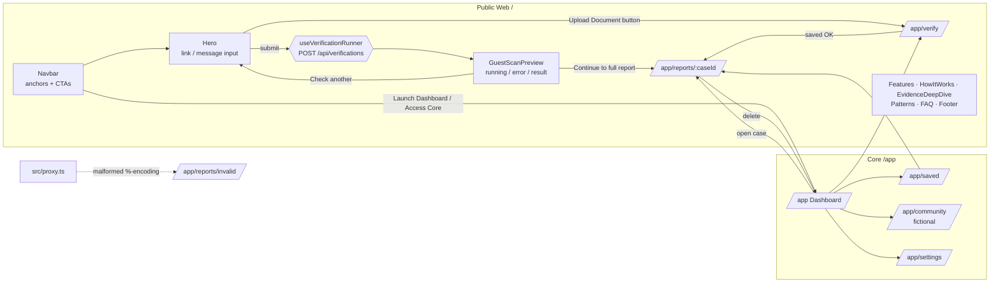
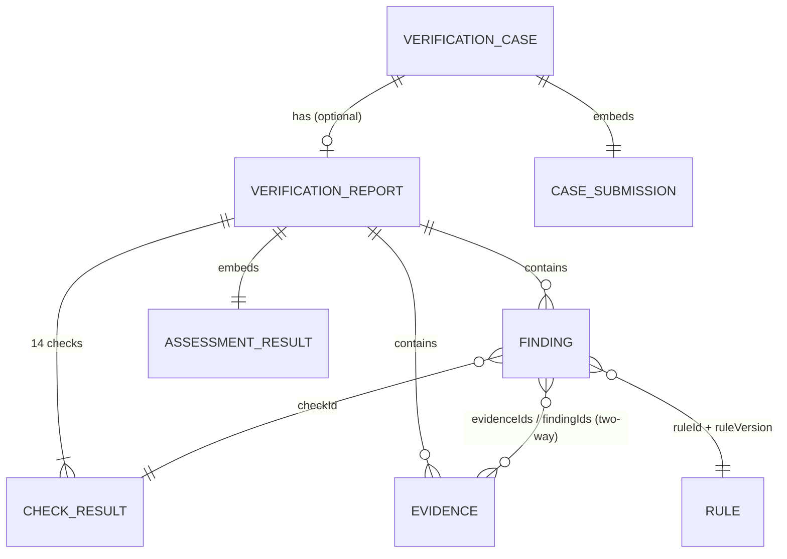
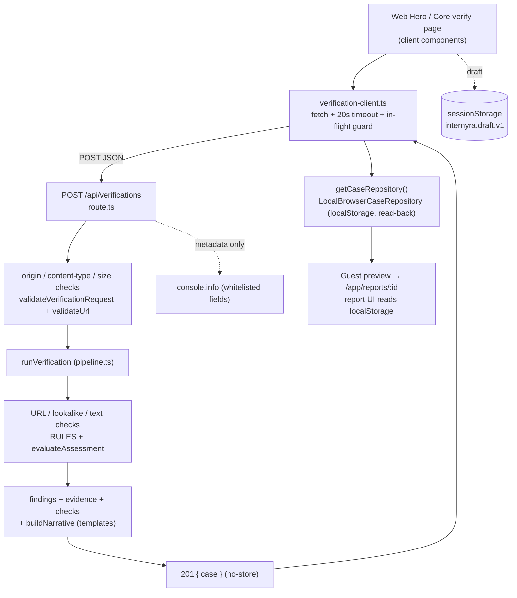
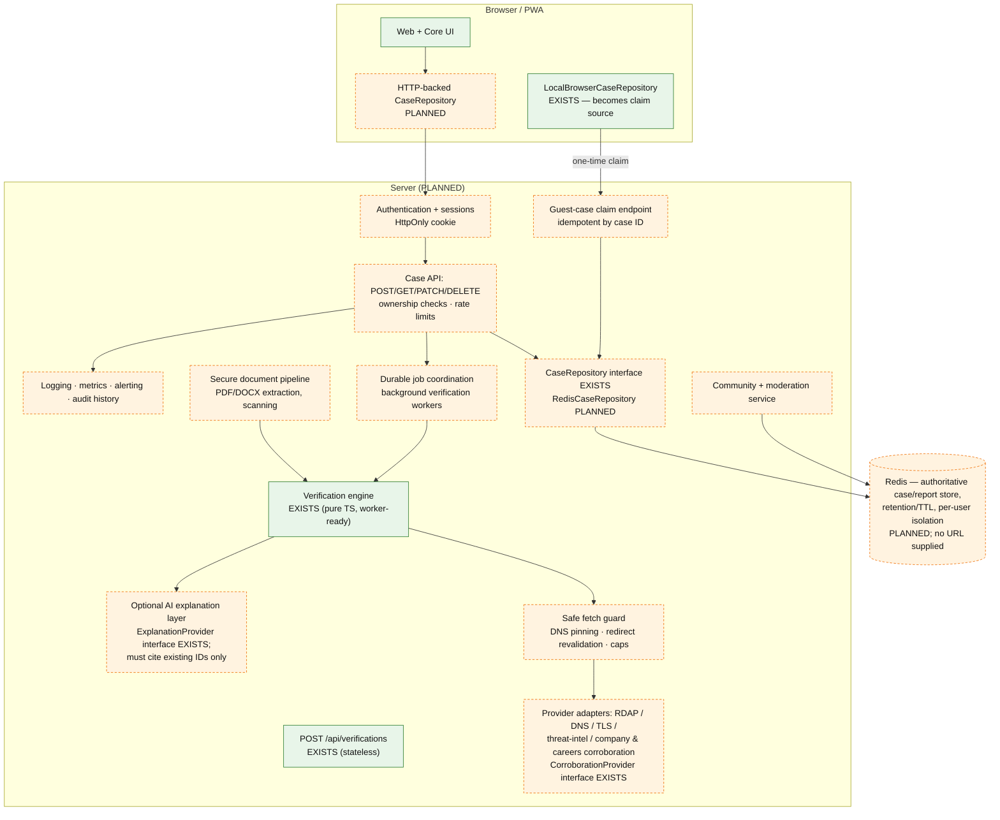

# INTERNYRA — Complete Project Audit & Technical Master Report

| | |
|---|---|
| **Audit date** | 2026-11-11 (UTC 07:18–07:21 for command runs) |
| **Repository** | `/Users/abhishek/Developer/Clg/Projects/Internyra` |
| **Branch / HEAD** | `main` @ `dfdf677` ("Initial commit from Create Next App") |
| **Working tree** | **Everything built so far is uncommitted** (8 modified tracked files + 12 untracked paths; see §1.3) |
| **Audit type** | Read-only. The only file created is this report. No source, config, dependency or lockfile was changed. |
| **Auditor's headline** | A *functional local prototype*: a working, well-tested, local-only heuristic checker with a polished UI. Not an MVP, not production-ready. |

---

## Table of contents

1. [Audit scope, method and evidence conventions](#1-audit-scope-method-and-evidence-conventions)
2. [Product overview](#2-product-overview)
3. [Feature inventory](#3-feature-inventory)
4. [Route and navigation map](#4-route-and-navigation-map)
5. [Frontend and UI/UX audit](#5-frontend-and-uiux-audit)
6. [Brand identity and logo](#6-brand-identity-and-logo)
7. [Three.js Evidence Lens](#7-threejs-evidence-lens)
8. [Animation and interaction inventory](#8-animation-and-interaction-inventory)
9. [Verification engine](#9-verification-engine)
10. [Data models and types](#10-data-models-and-types)
11. [API and internal service architecture](#11-api-and-internal-service-architecture)
12. [Storage, persistence and Redis](#12-storage-persistence-and-redis)
13. [Security audit](#13-security-audit)
14. [Privacy and data governance](#14-privacy-and-data-governance)
15. [Community and moderation](#15-community-and-moderation)
16. [PWA and mobile](#16-pwa-and-mobile)
17. [Testing and quality assurance](#17-testing-and-quality-assurance)
18. [Build, environment, configuration and dependencies](#18-build-environment-configuration-and-dependencies)
19. [Technical debt and known-issues register](#19-technical-debt-and-known-issues-register)
20. [Production-readiness assessment](#20-production-readiness-assessment)
21. [Future architecture (PLANNED — NOT IMPLEMENTED)](#21-future-architecture-planned--not-implemented)
22. [Implementation roadmap](#22-implementation-roadmap)
23. [Open decisions and information required from the owner](#23-open-decisions-and-information-required-from-the-owner)
24. [Executive summary](#24-executive-summary)
- [Appendix A — File and module inventory](#appendix-a--file-and-module-inventory)
- [Appendix B — Rule registry](#appendix-b--rule-registry)
- [Appendix C — Glossary](#appendix-c--glossary)
- [Appendix D — Commands executed in this audit](#appendix-d--commands-executed-in-this-audit)

---

## 1. Audit scope, method and evidence conventions

### 1.1 Method

Source code and observed behaviour are the evidence. Earlier assistant reports, README text and code comments were **not** treated as proof. Where documentation and code disagree, the discrepancy is listed in [§19](#19-technical-debt-and-known-issues-register) and the code is trusted.

Activities performed in this audit session:

- Read every application-authored source file relevant to the 28 audit areas (engine, API, persistence, components, 3D, PWA, tests, configs, docs).
- Ran the project's five existing commands (typecheck, lint, unit, build, e2e) and recorded results ([Appendix D](#appendix-d--commands-executed-in-this-audit)).
- Ran two small scratch experiments (copies of regexes from `src/lib/engine/text.ts`, in the session scratchpad, **outside the repo**) to measure regex timing and test negation handling.
- Grepped for dangerous APIs (`dangerouslySetInnerHTML`, `innerHTML`, `eval`), outbound network calls, storage use, env use, cookies, rate-limit/CORS/CSRF code.

Not performed in this audit (see per-section limitations):

- No new browser screenshots were taken in this session. Visual judgments below come from static source inspection plus screenshots viewed in the immediately preceding work session (hero at 1440 px and a 360 px full-page capture; tablet/phone numeric layout data). **Visual QA is therefore limited.**
- No Lighthouse, axe, contrast measurement, FPS/frame-time or memory profiling.
- No `npm audit` / vulnerability scan (requires network; not already executed).
- No Safari / Firefox / real-device testing. The Playwright projects are Chromium-based only.
- No penetration test.

### 1.2 Status vocabulary

`IMPLEMENTED_AND_TESTED` · `IMPLEMENTED_NOT_INDEPENDENTLY_TESTED` · `PARTIALLY_IMPLEMENTED` · `MOCK_OR_SAMPLE_ONLY` · `DOCUMENTED_BUT_NOT_IMPLEMENTED` · `NOT_IMPLEMENTED` · `BLOCKED_BY_MISSING_CONFIGURATION` · `FAILED_OR_BROKEN` · `UNKNOWN`.

"Tested" means an automated test in the repo executes the behaviour and passed in this audit's run, or I observed it directly. Test names are quoted from `tests/`.

### 1.3 Repository state

```
branch: main            HEAD: dfdf677 Initial commit from Create Next App
 M .gitignore  M README.md  M next.config.ts  M package-lock.json  M package.json
 M src/app/globals.css  M src/app/layout.tsx  M src/app/page.tsx
?? docs/  playwright.config.ts  public/brand/  public/manifest.json  public/sw.js
?? src/app/api/  src/app/app/  src/components/  src/lib/  src/proxy.ts  src/types/
?? tests/  vitest.config.mts
```

- **The whole product has no version history.** Only the create-next-app scaffold is committed. This is itself a risk (R-01 in §19).
- Tracked files that are still create-next-app leftovers: `public/file.svg`, `globe.svg`, `next.svg`, `vercel.svg`, `window.svg`, `src/app/favicon.ico`.
- Generated, git-ignored directories exist: `.next/` (346 MB), `node_modules/` (589 MB), `test-results/`, `tsconfig.tsbuildinfo`. The e2e run in this audit regenerated `.next/` (build) and `test-results/`; none are tracked.
- No `.env*` files exist. No `.github/` (no CI). No dev server was listening at audit start.
- Project instructions: [`AGENTS.md`](AGENTS.md) (tracked) — warns that this Next.js version has breaking changes and to read `node_modules/next/dist/docs/` first.
- Size of authored content: ≈10,000 lines across `src/`, `tests/`, `docs/`, `public/` (wc total 10,066 incl. docs and SVG).

---

## 2. Product overview

| Item | Value |
|---|---|
| **Name** | Internyra |
| **Purpose** | Help students investigate internship links, recruiter messages and offer text by showing what a local rule engine observed, which checks could not run, and what to verify independently. |
| **Problem** | Internship/recruitment scams (advance fees, fake recruiters, lookalike domains, phishing forms, chat-app-only "interviews"). Students lack a quick, transparent way to examine suspicious opportunities. |
| **Audience / personas** | Students and early-career applicants (primary). Secondary: university career offices, parents/advisers (not designed for explicitly). |
| **Use cases** | (1) Paste a link → structural lookalike/transport warnings. (2) Paste a recruiter message → fee/OTP/pressure/chat-app patterns. (3) Upload a `.txt` offer → same text analysis. (4) Re-open/save/export/delete past reports. |
| **Value proposition (as implemented)** | Transparent, deterministic, explainable heuristics; every finding cites evidence; unavailable checks are listed, never faked; no numeric "trust score". |
| **Surfaces** | Public **Web** (landing + guest check), **Core** app (`/app/*`), installable **PWA** shell. |
| **Stage** | Local demo/prototype. No accounts, no server persistence, no external data sources. |

**Principles evident in code:** never present absence of warnings as safety (`rules.ts` ASSESS-5/6); never invent sources/timestamps (`pipeline.ts` evidence `capturedAt` = engine run time, `retrievalStatus: "LOCAL_ANALYSIS"`); no numeric probability (`rules.ts` header comment + no score field in types); explicit limitations per finding.

**Internyra is not a guaranteed fraud detector.** It checks only what the user supplies, with a small hand-maintained rule set; it contacts no website, registry, DNS, or threat feed.

**Current vs vision**

| Vision (not built) | Current reality |
|---|---|
| Authenticated accounts, claim guest cases | No auth; `owner: { kind: "LOCAL_DEVICE" }` only |
| Redis-backed authoritative storage | None; browser `localStorage` only |
| Domain age / DNS / TLS / page fetch / threat intel / company corroboration | All `UNAVAILABLE` in every report |
| PDF/DOCX analysis | Refused with explanation; only UTF-8 `.txt` |
| Community reports with moderation | 3 fictional fixtures + tab-local draft form |
| AI explanations | Interface only (`ExplanationProvider`); deterministic templates used |

---

## 3. Feature inventory

### 3.1 Public Web

| Feature | Status | Implementation evidence | Test evidence |
|---|---|---|---|
| Navigation (desktop + mobile drawer) | IMPLEMENTED_AND_TESTED | [`src/components/web/Navbar.tsx`](src/components/web/Navbar.tsx): anchor links `#features #how-it-works #evidence #threat-patterns #faq`, CTAs to `/app`; mobile menu button with `aria-expanded` | e2e "Get started leads straight to /app…" (mobile path opens menu → "Open Core Dashboard") |
| Brand/logo | IMPLEMENTED_NOT_INDEPENDENTLY_TESTED | [`Logo.tsx`](src/components/brand/Logo.tsx) | none (see §6) |
| Landing page composition | IMPLEMENTED_AND_TESTED | [`src/app/page.tsx`](src/app/page.tsx) composes Navbar, Hero, GuestScanPreview, TrustStrip, Features, HowItWorks, EvidenceDeepDive, MissionBanner, Reviews, FaqSection, Footer | overflow tests per route |
| Hero + guest input (link / message tabs) | IMPLEMENTED_AND_TESTED | [`Hero.tsx`](src/components/web/Hero.tsx): `submit()` validates with `validateUrl` / `MIN_TEXT_LENGTH`, saves draft, calls `onSubmit` | journeys: validation errors, success, keyboard flow |
| Example buttons (3 fictional inputs) | IMPLEMENTED_AND_TESTED | `Hero.tsx` `EXAMPLES` (mixed-script `.example` link, Instagram reel link, fee message at "Northwind Example Labs") | e2e: social → Insufficient Data; mixed-script → Needs Review + URL-005 |
| Guest verification | IMPLEMENTED_AND_TESTED | `useVerificationRunner` in [`verification-client.ts`](src/lib/verification-client.ts) → `POST /api/verifications` | journeys 1, failure/retry, offline, duplicate submit |
| Offer-letter input on landing page | PARTIALLY_IMPLEMENTED | Hero "Upload Document" button only navigates to `/app/verify?tab=document` (`Hero.tsx` ~line 218); no upload on the landing page | not tested |
| Preliminary result preview | IMPLEMENTED_AND_TESTED | [`GuestScanPreview.tsx`](src/components/web/GuestScanPreview.tsx): running / error / done states; ≤2 key findings via `selectKeyFindings` | journeys, "clean link never labelled safe" |
| Guest → Core handoff | IMPLEMENTED_AND_TESTED | "Continue to full report" → `router.push('/app/reports/<id>?from=guest')` (`src/app/page.tsx`); same stored case, **no re-run** | journey 1 asserts same case ID, URL, "Continued from your guest preview" |
| Features / TrustStrip / HowItWorks / EvidenceDeepDive / Reviews / MissionBanner | IMPLEMENTED_NOT_INDEPENDENTLY_TESTED (static content) | `src/components/web/*.tsx`. Sample panels use real engine output for fictional inputs. Copy guard test scans body text for banned claims | e2e "site copy makes no unsupported storage…" (guards only the listed regexes) |
| Community section on landing page | NOT_IMPLEMENTED | The landing page has no community section. `Reviews.tsx` is a "Common patterns" section of 3 fictional scenarios (misleading filename) | — |
| FAQ accordion | IMPLEMENTED_NOT_INDEPENDENTLY_TESTED | [`FaqSection.tsx`](src/components/web/FaqSection.tsx), `aria-expanded` buttons, 6 Q&As | none specific |
| Footer | IMPLEMENTED_NOT_INDEPENDENTLY_TESTED | [`Footer.tsx`](src/components/web/Footer.tsx) | none |
| Mobile responsiveness | IMPLEMENTED_AND_TESTED (overflow only) | no-horizontal-overflow test for 7 routes at 1280 px and 360 px; populated-report overflow test | `ui-pwa.spec.ts` |

### 3.2 Core application (`/app/*`)

| Feature | Status | Implementation evidence | Test evidence |
|---|---|---|---|
| Shell, desktop sidebar, mobile bottom nav, search box | IMPLEMENTED_AND_TESTED | [`AppShell.tsx`](src/components/app/AppShell.tsx) `NAV_ITEMS` (Dashboard, New Verification, Saved Cases, Community, Settings); header search routes to `/app?search=` | touch-target test (5 links ≥44 px) |
| Dashboard + metrics | IMPLEMENTED_AND_TESTED | [`src/app/app/page.tsx`](src/app/app/page.tsx): 4 count tiles, assessment ring "Follow-up" = (HIGH_RISK+NEEDS_REVIEW)/total, case list `data-testid="case-list"`, search filter | journey "verify a message, see it on the dashboard…" |
| Demo-mode indicator | IMPLEMENTED_AND_TESTED | [`DemoModeNotice.tsx`](src/components/app/DemoModeNotice.tsx) | journey 2 asserts text |
| New verification (link + optional text + claimed company) | IMPLEMENTED_AND_TESTED | [`verify/page.tsx`](src/app/app/verify/page.tsx) 3 tabs: Internship URL, Offer Document (.txt), Recruiter Message | journeys: field errors, drafts survive refresh, document flow |
| Document handling | PARTIALLY_IMPLEMENTED | `.txt` only, ≤100 KB, read in browser via `validateTextDocument` ([`files.ts`](src/lib/engine/files.ts)); PDF/DOCX refused | e2e + `files.test.ts` |
| Report detail (overview, findings, evidence, checks, limitations) | IMPLEMENTED_AND_TESTED | [`reports/[caseId]/page.tsx`](src/app/app/reports/%5BcaseId%5D/page.tsx) 5 `role="tab"` panels | journeys, overflow-per-tab |
| Save/bookmark, delete, export one report | IMPLEMENTED_AND_TESTED | `handleToggleSave`, `handleDelete` (confirm dialog), `exportCase` (Blob download of full case JSON) | saved-cases test; delete + cancel tests. **Export of a single report has no download assertion** |
| Saved cases | IMPLEMENTED_AND_TESTED | [`saved/page.tsx`](src/app/app/saved/page.tsx) filter by assessment + text search, unbookmark | "saved cases page lists bookmarked reports" |
| Settings: export all / delete all | IMPLEMENTED_NOT_INDEPENDENTLY_TESTED | [`settings/page.tsx`](src/app/app/settings/page.tsx) `handleExportJSON`, `handleClearAll`; persistence `clearAll` is unit-tested, the UI is not | `persistence.test.ts` (repo only) |
| Community | MOCK_OR_SAMPLE_ONLY | §15 | fixture + label tests |

### 3.3 Guest workflow (code-traced)

1. `Hero.tsx` validates input (URL via `validateUrl`; message ≥20 chars), writes a **draft** to `sessionStorage["internyra.draft.v1"]` on every keystroke and on submit (lines ~76, ~100), calls `onSubmit`.
2. `useVerificationRunner.start()` (`verification-client.ts`): ignores a second call while one is in flight (`inFlight` ref), sets phase `running`, `fetch('/api/verifications', 20 s AbortController timeout)`.
3. Success → `getCaseRepository().createCase(case)` (read-back verified) → `saveDraft({lastCaseId})` → phase `done`. Persist failure → phase `done` with `saveError`; the "Continue" button is disabled and "Retry saving" re-persists the **in-memory** case.
4. "Continue to full report" → `/app/reports/<caseId>?from=guest`. The **original case ID and submitted URL are preserved** (same record).
5. **Refresh** (same tab): `page.tsx` reads `lastCaseId` from the session draft and re-reads the case from `localStorage`; preview restored (e2e-tested). **New tab / browser restart**: `sessionStorage` is gone → no preview restoration; the report remains reachable via `/app` dashboard because it lives in `localStorage` (not separately tested).
6. **Storage failure**: tested via injected `QuotaExceededError` ("This result was not saved."), and via blocked `localStorage` on the dashboard ("Browser storage is unavailable"). If the tab is refreshed while a save has failed, the result is lost (nothing server-side).

> Privacy nuance (code-evidenced): the guest draft stores the **full pasted message text** in `sessionStorage` until the tab closes (`Hero.tsx` `handleChange` → `saveDraft`). It is not cleared after a successful guest check (only Core's verify page calls `clearDraft`). See §14.

### 3.4 PWA — see §16.

---

## 4. Route and navigation map

### 4.1 Routes

| URL | Purpose | Component | Layout | Rendering | Auth | Status | Known issues |
|---|---|---|---|---|---|---|---|
| `/` | Landing + guest check | [`src/app/page.tsx`](src/app/page.tsx) (`"use client"`) | root [`layout.tsx`](src/app/layout.tsx) | Static shell (○) + client hydration | none | IMPLEMENTED_AND_TESTED | whole page is a client component (no server rendering of marketing sections) |
| `/app` | Dashboard | [`app/app/page.tsx`](src/app/app/page.tsx) | `CoreLayout` → `AppShell` | Static (○), client data | none | IMPLEMENTED_AND_TESTED | — |
| `/app/verify` | New verification (`?tab=link\|message\|document`) | [`verify/page.tsx`](src/app/app/verify/page.tsx) | Core | Static, client | none | IMPLEMENTED_AND_TESTED | — |
| `/app/reports/[caseId]` (`?from=guest`) | Full report | [`reports/[caseId]/page.tsx`](src/app/app/reports/%5BcaseId%5D/page.tsx) | Core | Partial prerender (◐), client data | none | IMPLEMENTED_AND_TESTED | unknown valid-format ID → HTTP 200 + "Report not found" (reports are browser-local) |
| `/app/reports/invalid` | Target of malformed-encoding redirect (same dynamic route; ID fails `CASE_ID_PATTERN`) | same | Core | — | none | IMPLEMENTED_AND_TESTED | — |
| `/app/saved` | Bookmarked cases | [`saved/page.tsx`](src/app/app/saved/page.tsx) | Core | Static, client | none | IMPLEMENTED_AND_TESTED | — |
| `/app/community` | Fictional preview | [`community/page.tsx`](src/app/app/community/page.tsx) | Core | Static, client | none | MOCK_OR_SAMPLE_ONLY | — |
| `/app/settings` | Export / delete local data | [`settings/page.tsx`](src/app/app/settings/page.tsx) | Core | Static, client | none | PARTIALLY_IMPLEMENTED | **inaccurate privacy "guarantees" card (§19 D-01)** |
| `/_not-found` | Next default 404 | framework | — | Static | — | — | default styling |
| `/manifest.json`, `/sw.js` | PWA assets | [`public/`](public) | — | static files; `sw.js` served with `no-cache` | — | IMPLEMENTED_AND_TESTED | — |

Behaviour of path handling (observed via curl + Playwright last session, re-asserted by `report-routes.spec.ts` in this audit's e2e run): well-formed unknown ID → 200 + not-found card; suspicious but decodable IDs (`a%2Fb`, `..%2F..%2Fetc`, `%00`, `%3Cscript%3E`, `case_x%2F..%2F`) → 200 + "This report link isn't valid"; malformed percent-encoding (`%`, `%zz`, `%E0%A4%A`, `%C0%AF`) → **307 → `/app/reports/invalid`** via [`src/proxy.ts`](src/proxy.ts) (without it, production `next start` returned a bare 500; dev returned 400). `%2e%2e` yields a framework-level 308 to `/app`. Other paths with malformed encoding (`/%zz`, `/app/%zz`) were observed to return 404.

### 4.2 API routes

| Method + path | Purpose | Handler | Status |
|---|---|---|---|
| `POST /api/verifications` | Validate a submission, run the engine, return a case | [`route.ts`](src/app/api/verifications/route.ts) | IMPLEMENTED_AND_TESTED (§11) |

No other API routes exist. No `GET`/`PATCH`/`DELETE` for cases (nothing is stored server-side).

### 4.3 Navigation diagram



---

## 5. Frontend and UI/UX audit

### 5.1 Stack (observed from `package.json` / installed versions)

| Item | Value |
|---|---|
| Framework | Next.js **16.4.2**, App Router, `cacheComponents: true`, `partialPrefetching: true` ([`next.config.ts`](next.config.ts)); Turbopack |
| React | 19.3.0 (react-dom 19.3.0) |
| TypeScript | 5.9.3, `strict: true`, path alias `@/* → ./src/*` ([`tsconfig.json`](tsconfig.json)) |
| Tailwind | 4.3.3 via `@import "tailwindcss"` in [`globals.css`](src/app/globals.css); **no tailwind config file**; `@tailwindcss/turbopack` 4.3.3 wired through `next.config.ts` `turbopack.rules` |
| Icons | `lucide-react` 1.59.0 (inline React icons) |
| Fonts | Geist Sans + Geist Mono via `next/font/google` ([`layout.tsx`](src/app/layout.tsx)) — **build requires network/cached font fetch** |
| Images/assets | No raster images. SVG logos in `public/brand/`; no `next/image` use |
| Breakpoints | Tailwind defaults (`sm 640`, `md 768`, `lg 1024`) used inline; `md:` toggles sidebar vs mobile bottom nav |
| Lint | ESLint 9.39.5 + `eslint-config-next` core-web-vitals + typescript |

### 5.2 Design tokens (verbatim from `globals.css` `:root`)

| Group | Tokens |
|---|---|
| Canvas / surfaces | `--canvas #f7f6f2`, `--canvas-subtle #f0ede4`, `--surface-0 #ffffff`, `--surface-1 #fbfbfa`, `--surface-2 #f4f2eb`, `--surface-accent #eef2fb`, `--surface-hover #f1eee6` |
| Ink | `--ink-primary #191d26`, `--ink-secondary #474d5a`, `--ink-muted #737a8c`, `--ink-faint #a4abb8` |
| Brand | `--brand-primary #365ad9`, `--brand-secondary #2546b8`, `--brand-accent #4b6fe6`, `--brand-glow rgba(54,90,217,.08)` |
| Borders | `--border-light #e5e4de`, `--border-subtle #edece6`, `--border-focus #365ad9` |
| Status (bg/text/border/dot) | safe `#edf7f2/#1b7340/#c6e9d5/#22a05b` · risk `#fdf1f0/#b82c24/#f7cac7/#de3b31` · review `#fef7ec/#9e5b0e/#fce1b6/#d97706` · insufficient `#f4f3ef/#5c6270/#dddcd6/#8e95a5` |
| Radius | `--radius-sm 8px`, `md 12px`, `lg 16px`, `xl 24px`, `full 9999px` |

Light-mode only; **no dark theme** (`body` forced to `--canvas`). `Logo` has a `theme="dark"` variant and `logo-full-dark.svg` exists, unused.

### 5.3 Does Web = Core = PWA share one design system?

Largely yes: the same CSS variables (≈821 `[var(--…)]` usages) and the same header/typography idioms appear on Web and Core; the PWA is the same app. Inconsistencies (static inspection):

1. **Two semantic colour systems.** [`components/report/meta.tsx`](src/components/report/meta.tsx) styles assessment/severity/check badges with raw Tailwind palette classes (`bg-rose-50 text-rose-700`, `amber`, `emerald`, `slate`, `yellow` — 29 occurrences), while pages use `--status-*` tokens. Colours can drift apart.
2. **Logo** uses Tailwind `slate/blue` classes and indigo gradients (`#2563eb → #4f46e5 → #6366f1`) rather than `--brand-primary #365ad9`. Favicon dark tile `#0f172a`.
3. **Focus ring** hard-coded `#3b82f6` in `globals.css` (`:focus-visible`) instead of `--border-focus`.
4. **PWA metadata**: manifest `theme_color #ffffff` / `background_color #fafbfe` vs `viewport.themeColor #f7f6f2` / canvas `#f7f6f2`.
5. Tokens are used only via arbitrary values (`bg-[var(--surface-0)]`); they are not registered in Tailwind `@theme`, so there are no semantic utilities and class strings are long and repetitive.
6. Unused style utilities in `globals.css`: `.animate-pulse-glow`, `@keyframes shimmer`, `.surface-card`, `.surface-inset`, `.border-hairline`.

### 5.4 UI quality assessment

*Basis: static source inspection plus limited screenshots from the prior session (landing hero at 1440 px, full-page capture at 360 px). Not a full visual review.*

| Dimension | Finding | Evidence |
|---|---|---|
| Hierarchy / typography | Strong, consistent: large bold hero heading, mono micro-labels, `text-xs` body in Core. Core body copy at 11–12 px is small; many `text-[10px]`/`text-[11px]` labels | grep: `font-mono` ×215 |
| Redundant uppercase labels | Still prevalent: `uppercase` ×65 (section eyebrows, tab labels, table headers) in addition to nav; this was a flagged design smell and is **not** resolved | grep |
| Card overuse | `rounded-xl`/`rounded-2xl` ×66; nearly every section is a bordered card, often nested (card in card in Features/EvidenceDeepDive/Report). Repeated three-up card grids in TrustStrip/HowItWorks/Patterns | static |
| Spacing | Consistent section rhythm (`py-20 md:py-24`); not visually measured | static |
| Navigation clarity | Web: anchor nav + two CTAs; Core: sidebar/bottom bar with 5 items. "Launch Dashboard" and "Access Core" both go to `/app` (two CTAs, one destination) | `Navbar.tsx` |
| Responsive | No horizontal overflow at 1280 px / 360 px on 7 routes (tested). Hero lens placed below text on <lg | e2e; screenshots |
| Reusability | Report/assessment helpers shared via `meta.tsx`; but page-level markup (cards, tiles) is copy-pasted rather than componentised; `Reviews.tsx` name is wrong for its content | static |
| Accessibility | Labelled inputs (`htmlFor`), `role="alert"` errors, `aria-live`/`role="status"` on progress, `role="tablist/tab/tabpanel"`, `aria-pressed` toggles, skip link **absent**, landmark `<main>` present on landing, `aria-expanded` on menus. Report tabs lack roving-tabindex/arrow-key handling (buttons only) | static; keyboard e2e covers landing flow only |
| Keyboard | Landing flow tested (Tab to input, Enter submit, focus outline on Continue). Core and report tabs not keyboard-tested | e2e |
| Touch targets | Mobile bottom-nav verified ≥44×44 px (5 links). Other controls (e.g. 36 px `h-9` icon buttons, `text-xs` pill buttons) not measured | e2e |
| Focus indicators | Global `:focus-visible` 2 px outline; the Continue button's computed outline asserted non-`none` | e2e |
| Error states | Clear: field-level `role="alert"`, retry buttons, storage notices with recovery actions | static + e2e |
| Empty states | Dashboard zero state with CTA (tested); saved/no-match states exist | e2e (dashboard) |
| Loading states | Now tied to request lifecycle (`GuestScanPreview` running, verify page "Waiting for the analysis") listing planned/unavailable checks from the actual request (`describePlannedChecks`). Skeletons use `animate-pulse` | static + e2e "in-progress state reflects the real request" |
| Safe areas | `.pb-safe` helper exists; `viewport-fit=cover` is **not** set (grep: none), so whether `env(safe-area-inset-*)` takes effect on notched devices is **UNKNOWN** | static |

---

## 6. Brand identity and logo

| Asset | Path | Notes |
|---|---|---|
| React logo | [`src/components/brand/Logo.tsx`](src/components/brand/Logo.tsx) | Inline 48×48 SVG: two partial "aperture" ring arcs (upper opacity .95, lower .75), a forward chevron/wedge, a focus dot; wordmark "Internyra" + blue dot. Props: `variant (icon|full|horizontal)`, `size (sm..xl)`, `theme (light|dark|auto)`, `asLink`, `href`. Used by Navbar, Footer, AppShell. |
| Icon SVG | [`public/brand/logo-icon.svg`](public/brand/logo-icon.svg) (1.4 KB) | Same mark; used as apple-touch icon and manifest icon; precached by the SW |
| Favicon | [`public/brand/favicon.svg`](public/brand/favicon.svg) (1.0 KB) | 32×32 dark rounded tile with the mark; referenced by `metadata.icons.icon` and manifest |
| Full logos | `public/brand/logo-full.svg`, `logo-full-dark.svg` | **Orphaned**: no code references |
| Legacy | `src/app/favicon.ico` | create-next-app default; coexists with the SVG favicon |

Concept: "aperture/focus" ring with a forward chevron — ties to the "Evidence Lens". Gradients are blue→indigo.

Gaps/inconsistencies: no PNG icons (192/512), no maskable icon, no monochrome/mask-icon, `variant="icon"` and `"horizontal"` and `theme="auto"` never used; colours differ from design tokens (§5.3); `Logo` gradient IDs are suffixed by size (`nyraGrad-${size}`), which means two logos of the same size on one page duplicate SVG IDs (e.g. Navbar + Footer both `md`) — harmless in practice but technically invalid HTML. **Small-size legibility was not visually inspected in this audit** — no claim of professional validation.

---

## 7. Three.js Evidence Lens

**Status: IMPLEMENTED_AND_TESTED for rendering, drag, offscreen pause, scroll-not-hijacked, touch swipe scroll, reduced-motion fallback and no-WebGL fallback. Pointer parallax, scroll-driven layer separation, context-loss fallback and visual quality are IMPLEMENTED_NOT_INDEPENDENTLY_TESTED.**

### 7.1 Files and integration

| File | Role |
|---|---|
| [`src/components/3d/EvidenceLensHero.tsx`](src/components/3d/EvidenceLensHero.tsx) | `next/dynamic(() => import("./EvidenceLens"), { ssr: false, loading: <EvidenceLensFallback/> })` — keeps `three` out of SSR and of the initial bundle path |
| [`src/components/3d/EvidenceLens.tsx`](src/components/3d/EvidenceLens.tsx) (703 lines) | Scene, interaction, fallback (`EvidenceLensFallback`, an SVG "schematic") |
| [`src/components/web/Hero.tsx`](src/components/web/Hero.tsx) | Mounts `<EvidenceLensHero />` in the right column (`lg:col-span-5`). **It is the only consumer.** |

Dependencies: `three` ^0.186.1, `@types/three`, and `three/examples/jsm/environments/RoomEnvironment.js`.

### 7.2 Scene construction (line refs in `EvidenceLens.tsx`)

| Aspect | Implementation |
|---|---|
| Camera | `PerspectiveCamera(38°)` (l.105); `fitCamera()` (l.109–112) positions it at `FIT_RADIUS(2.85)/(tan(fov/2)·min(1,aspect)) + 0.6` so the model fits the narrower axis; re-run on resize |
| Renderer | `WebGLRenderer({antialias:true, alpha:true, powerPreference:"high-performance"})` (l.117); `setPixelRatio(min(devicePixelRatio, 2))` (l.123); `ACESFilmicToneMapping`, exposure 1.15 |
| Environment | `PMREMGenerator` + `RoomEnvironment` (l.139–143), `scene.environmentIntensity = 0.55` (added because metals rendered near-black without an environment) |
| Lights | Ambient 1.2; directional key (2.2) + fill (1.2); point "core" light 2.5 whose intensity pulses (`2.2 + sin(t·1.5)·0.4`) |
| Geometry (11 meshes + 1 `Points`) | open barrel cylinder (64 seg), 2 grip tori (16×72), front rim ring, inner liner cylinder, 3 glass cylinders (front/mid/rear; rear reuses front's material), 3 reticle wafer planes (3.5×3.5), 45 particles |
| Materials | 3× `MeshStandardMaterial` (metal), 2× `MeshPhysicalMaterial` with `transmission` 0.92–0.94 (glass), 3× `MeshBasicMaterial` (wafers, transparent, `depthWrite:false`), `PointsMaterial` (additive) |
| Textures | 3 procedural **1024×1024 `CanvasTexture`s** (telemetry ring/ticks/text, crosshair/chevrons, hex iris) generated at mount, mipmapped (l.167–290) |
| Fabricated metric | The telemetry wafer bakes in the text **"LATENCY 4.2ms · PURE DETERMINISTIC"** (l.214) — a decorative, made-up number; HUD also shows "F/1.4 · 85MM FL · PBR" and "APERTURE RETICLE 2.4". See D-07. |

### 7.3 Interaction behaviour

| Behaviour | Implementation | Verified? |
|---|---|---|
| Pointer parallax | `mousemove` on the **container**: `targetRotY = base + x·0.35`, `targetRotX = base − y·0.28` (rad) | Not tested; code-read only |
| Damping | per-frame `+= (target − current)·0.06` (l.564–566) — **frame-rate dependent** (not delta-time based), so settling speed varies with refresh rate | Not measured |
| Drag orbit | `pointerdown` on container (pointer capture) + `pointermove/up/cancel` on `window`; clamped to ±π/4 around the rest pose; releases back to rest (`targetRot = base`); HUD text toggles `INTERACTING ↔ CALIBRATED` | **Tested** (e2e: status text changes, canvas image differs, returns to CALIBRATED, page input still focusable) — desktop only |
| Scroll separation | `scrollY/600` clamped 0–1 → `targetSeparation = progress·0.55` moves front/rear wafers and glass in Z | Runs without error; separation visuals not tested |
| Does not hijack scroll | passive `scroll` listener; canvas `touch-pan-y`; wheel scroll test | **Tested** (desktop wheel; mobile touch swipe via CDP) |
| Offscreen pause | `IntersectionObserver` (threshold .05) sets `isVisible`; the rAF loop **keeps scheduling** but skips rendering | **Tested** (draw-call counter = 0 when scrolled to `#faq`, >10 per 500 ms when visible) |
| Resize | `window.resize` → `fitCamera()` + `setSize`. No `ResizeObserver` (container-only size changes are not handled) | Not tested |
| Touch | `touch-action: pan-y` so vertical swipes scroll; horizontal drags work via pointer events | Swipe-scroll tested; horizontal touch drag not tested |
| Reduced motion | `prefers-reduced-motion` (live listener) → renders static SVG `EvidenceLensFallback`, no canvas | **Tested** |
| WebGL unavailable | `getContext("webgl")` probe (WebGL1) → fallback | **Tested** (forced `null`) |
| Context lost / renderer creation failure | `webglcontextlost` → `rendererFailed` → fallback; construction failure deferred via `queueMicrotask`. No `webglcontextrestored` handling | **Not tested** |
| Cleanup | `cancelAnimationFrame`, observer/listeners removed, `renderer.dispose()`, all geometries/materials/textures (incl. env) disposed, canvas removed. `forceContextLoss()` not called | Code-read; no leak test |
| A11y | wrapper `role="img"` with `aria-label`; HUD decorative | static |

### 7.4 Performance (no numbers invented)

- Observed only: in headless Chromium with hardware WebGL the scene rendered (draw counter > 10 per 500 ms) at 1440/1280/820/390/360 px widths with zero page errors; the canvas fits its panel (asserted). **No FPS, frame-time, memory, GPU, bundle-size or Lighthouse figures were measured.**
- Cost drivers by inspection: DPR up to 2; MSAA; two transmission materials (three.js adds an extra transmission render pass); three 1024² canvas textures generated on the main thread at mount; 12 draw objects; 45 points. The hidden-tab case is handled by the browser pausing rAF; the offscreen case by the early return.
- Mobile: same scene, same DPR cap (2), same textures; no reduced-quality path for low-end devices. Not profiled.
- Risk: `hasWebGL` probe creates a throwaway WebGL context on every mount (browser context limits).

---

## 8. Animation and interaction inventory

No animation library is installed (`package.json`: no framer-motion/gsap/etc.). All motion is CSS (Tailwind utilities + 3 custom keyframes), one Three.js loop, and `scrollIntoView`.

| Animation | Route/component | Implementation | Trigger | Reduced-motion support | Status |
|---|---|---|---|---|---|
| Fade-in on mount | most Core pages, report tabs, preview, FAQ answers, mobile menu | `.animate-fade-in` (`@keyframes fadeIn`, 0.35 s) in `globals.css` | mount | global `@media (prefers-reduced-motion)` forces 0.01 ms durations / 1 iteration | IMPLEMENTED |
| Spinner | Hero Inspect button, GuestScanPreview, verify page | Tailwind `animate-spin` | request running | global override (e2e checks computed duration on a pulse element) | IMPLEMENTED_AND_TESTED (indirect) |
| Pulse | Hero status dot, lens HUD dot, skeleton loaders (report/dashboard/AppShell) | Tailwind `animate-pulse` | always / loading | global override — e2e asserts `.animate-pulse` duration <0.01 s under reduced motion | IMPLEMENTED_AND_TESTED |
| Ping | Preview header dot while running | `animate-ping` | running | global override | IMPLEMENTED |
| Hover/active transitions | buttons, links, cards, nav | `transition-colors/-all/-transform`, `active:scale-[0.98]`, logo `group-hover:scale-105` | hover/press | global `transition-duration` override | IMPLEMENTED |
| Accordion / tab switch | FAQ chevron rotate; EvidenceDeepDive tabs; report tabs | state + CSS | click | global override | IMPLEMENTED |
| Smooth scroll | `html{scroll-behavior:smooth}`; `scrollToPreview`/`handleReset` in `page.tsx` use `scrollIntoView`/`scrollTo` | CSS + JS | submit / reset | CSS override; JS checks `matchMedia` and uses `auto` | IMPLEMENTED |
| Evidence Lens | Hero | Three.js rAF loop (§7) | always (when visible) | static fallback | IMPLEMENTED_AND_TESTED (partly) |
| Pulse-glow / shimmer | — | defined in CSS | **never used** | n/a | OBSOLETE |
| Page transitions | — | none | — | — | NOT_IMPLEMENTED |

Assessment: restrained; no duplicate animation libraries; the main performance concern is the lens. The global reduced-motion rule is broad (all animations/transitions to ~0 ms), which is acceptable. Decorative pulses (status dots) animate indefinitely.

---

## 9. Verification engine

Code: [`src/lib/engine/`](src/lib/engine) — pure TypeScript, **no React/Next imports**, usable in a worker. Versions: **engine 0.1.1, ruleset 2026.10.2, local lists 2026-10-19** ([`version.ts`](src/lib/engine/version.ts)).

### 9.1 Pipeline (`runVerification`, [`pipeline.ts`](src/lib/engine/pipeline.ts) l.716)

1. **Request validation** — [`request.ts`](src/lib/engine/request.ts) `validateVerificationRequest` (kind ∈ link/message/document; url ≤4096 chars; text 20–20 000 chars; company ≤120; documentName ≤200; `url` required for `link`, `text` required otherwise; `origin` = GUEST_PREVIEW or CORE).
2. **URL normalization/validation** — [`url.ts`](src/lib/engine/url.ts) `validateUrl`: trims; ≤2048; no whitespace; scheme must be http/https; rejects embedded credentials (pre-parse check on authority containing `@`); `new URL()` parse; lowercase host, strip trailing dot; hosts need ≥2 labels, labels ≤63, `[a-z0-9-]` only; rejects all-numeric TLD; drops fragment and default port; detects IPv4/IPv6 literals and classifies them; computes IDN/mixed-script flags.
3. **IP classification** — [`security/ip.ts`](src/lib/security/ip.ts): `public, loopback, private, link-local, metadata (169.254.169.254, fd00:ec2::254), multicast, reserved, unspecified, shared (100.64/10), documentation`; IPv4-mapped IPv6 unwrapped; 6to4/Teredo/NAT64 → `reserved`. **Used today only to describe literal-IP links** (no fetch exists).
4. **Punycode / mixed script** — [`punycode.ts`](src/lib/engine/punycode.ts): RFC 3492 decoder; `hasMixedConfusableScripts` flags a label containing Latin plus Cyrillic or Greek. Only evaluated when a label starts with `xn--`. Single-script whole-label lookalikes are **not** detected (stated in the finding's limitation).
5. **Local lists** — [`lists.ts`](src/lib/engine/lists.ts): `URL_SHORTENER_HOSTS` (17), `JOB_PLATFORM_HOSTS` (16), `SOCIAL_MEDIA_HOSTS` (15), `FREE_EMAIL_DOMAINS` (16), `MULTI_LABEL_SUFFIXES` (15; **not** the Public Suffix List — `registrableDomain` falls back to last two labels).
6. **URL checks** (`runUrlChecks` l.103): emits evidence `URL_ANALYSIS` + findings (see table).
7. **Lookalike check** (`runLookalikeCheck` l.317): only when a claimed company is supplied, the host is not an IP, and not on a job platform; compares company slug (legal suffixes stripped) with the registrable domain's first label using exact match, `homoglyphFold` (`rn→m`, `vv→w`, `0→o`, `1/l/|→i`, `5→s`) equality, or Levenshtein ≤ threshold (1, or 2 when slug ≥ 8 chars, only if slug ≥ 5 chars); also "extra words" / "subdomain only" / "no name".
8. **Text analysis** — [`text.ts`](src/lib/engine/text.ts) `analyzeText` (first 20 000 chars): sentence-level regex scans for payment requests (7 patterns), payment negation/reassurance, sensitive-data requests (OTP/password/bank/Aadhaar/PAN/SSN/passport… + request verb − negation), chat-app mentions (telegram/whatsapp/wechat/signal), urgency/no-interview, compensation claims, emails (≤5; free-provider tagging), organisation names (legal-suffix regex or `Company:` label; ≤5). **Nothing is inferred beyond literal matches** — no recruiter name, title or ownership is fabricated (unit-tested).
9. **Corroboration adapter** — [`corroboration.ts`](src/lib/engine/corroboration.ts): `CorroborationProvider` interface; `getConfiguredCorroborationProviders()` **returns `[]`**. `runCorroboration` (l.566) therefore records `company.corroboration` = `UNAVAILABLE`. Provider path (timeout via `withTimeout`, results → `EXTERNAL_SOURCE` evidence, findings COR-001/002/003) is exercised only with **test doubles** in unit tests.
10. **Recruiter-domain match** (`runRecruiterDomainCheck` l.627): `NOT_RUN` without emails; `UNAVAILABLE` unless an official corroboration supplies domains; REC-001/002 only then.
11. **Unavailable network checks** (`addUnavailableNetworkChecks` l.679): `domain.registration`, `domain.dns`, `domain.tls`, `page.fetch`, `reputation.threat-intel` = `UNAVAILABLE` with reasons (or `NOT_RUN` when no link).
12. **Assessment** — [`rules.ts`](src/lib/engine/rules.ts) `evaluateAssessment` (l.148): signals grouped by `signalGroup` so one underlying signal counts once (`groupRiskSignals`); rules ASSESS-1…6 (table in §9.4).
13. **Narrative** — [`explain.ts`](src/lib/engine/explain.ts) `buildNarrative`: fixed templates keyed by assessment and signal-group next steps; no AI. `ExplanationProvider` interface exists for a future validated AI layer.
14. **Integrity helper** — `validateReportIntegrity` (l.832): evidence IDs exist, finding↔evidence links two-way, unavailable/failed checks have limitation entries, INSUFFICIENT_DATA has null confidence. Used by tests, **not** at runtime in the API.
15. **Serialization** — `route.ts` returns `{ case }` JSON; the client stores it verbatim.
16. **Failure handling** — each step is wrapped by `guard(ownedChecks, fn)`; on throw, every unrecorded owned check is marked `FAILED` and lifecycle becomes `PARTIAL` (tested in `engine-failure.test.ts`).

**Outbound network:** none. Grep of `src/`: the only `fetch(` is the browser client calling `/api/verifications`. No `dns`, `net`, `http`, `undici`, sockets. **Verified by source inspection; there is no runtime egress test.**

### 9.2 Check availability table (14 `CheckId`s)

| Check ID | Name | Category | Availability now | Notes / evidence |
|---|---|---|---|---|
| `input.url` | Link validation & normalization | input | **Implemented, local** (runs when a link is given; else `NOT_RUN`) | `pipeline.ts` l.124 |
| `url.structure` | Link structure heuristics | domain | **Implemented, local** | scheme, IP host, port, shortener, IDN/mixed-script, platform/social lists |
| `domain.lookalike` | Lookalike name comparison | domain | **Implemented, local, conditional** (needs claimed company; not on IP/job-platform hosts) else `NOT_RUN` | l.317 |
| `content.payment` | Payment-request language | content | **Implemented, local** (text only) | text patterns |
| `content.sensitive-data` | Sensitive-detail requests | content | **Implemented, local** | |
| `content.contact-patterns` | Contact & pressure patterns | content | **Implemented, local** | chat app + urgency |
| `content.entities` | Names, emails & compensation extraction | content | **Implemented, local** | |
| `recruiter.domain-match` | Recruiter email domain comparison | recruiter | **Unavailable** (needs corroborated official domain) / `NOT_RUN` w/o emails | adapter only |
| `company.corroboration` | Company & opportunity corroboration | company | **Unavailable** — adapter exists, **no provider registered** | `getConfiguredCorroborationProviders()` → `[]` |
| `domain.registration` | Domain registration age | domain | **Unavailable** (no RDAP/WHOIS provider) | rule DOM-010 is reserved, never emitted |
| `domain.dns` | DNS & mail records | domain | **Unavailable** | no DNS performed |
| `domain.tls` | TLS certificate | domain | **Unavailable** | |
| `page.fetch` | Page content & redirects | domain | **Unavailable** — fetching deliberately disabled | needs fetch guard (§13/§22) |
| `reputation.threat-intel` | Threat-intelligence lookup | reputation | **Unavailable** | |

Classification: *implemented local deterministic* = 7; *configured external* = 0; *unavailable external* = 7 (incl. the 2 adapter-only); *planned integrations* = all 7 unavailable; *absent entirely* = no rule for unusually high pay, no email-header/SPF/DKIM analysis, no WHOIS, no screenshot/page analysis, no PDF/DOCX.

### 9.3 Rules (full registry in Appendix B) and behaviours verified

| Requirement | Result | Evidence |
|---|---|---|
| Clean URL never labelled positive | **Holds**: `INSUFFICIENT_DATA`, null confidence, summary "does not mean the opportunity is safe" | `engine.test.ts` "a clean URL alone is INSUFFICIENT_DATA"; e2e |
| `LOWER_CONCERN` reachable only with official corroboration | **Holds** (ASSESS-4); no provider exists, so it is unreachable in the running app | test "LOWER_CONCERN is only reachable through an official corroboration" |
| Social-media link ⇒ insufficient data | **Holds** unless a real signal exists: ASSESS-1/2/3 run first, so a social link + fee text → HIGH_RISK | tests: reel → INSUFFICIENT_DATA + URL-011; reel + payment text → HIGH_RISK |
| Missing corroboration ≠ fraud; free email ≠ fraud; young domain ≠ fraud | **Holds** (TXT-005 is `OBSERVATION/INFO`; DOM-010 never emitted; COR-003 is observation) | tests |
| Double counting | Mitigated via `signalGroup` (`host-form`: IP+port counted once; `lookalike`: URL-005/DOM-001/DOM-002 once). Related-but-distinct groups (payment HIGH + sensitive-data MEDIUM from one message) are counted as 2 independent groups → `HIGH` confidence | `rules.ts` l.180 `independentGroups = high+medium` |
| No numeric probability | **Holds** (no score field anywhere) | types |
| Confidence | Hand-assigned, **uncalibrated** labels (see below) | `rules.ts` |
| Deterministic | **Holds** for fixed clock/ID (tested); IDs are random UUIDs in production | test "is deterministic for the same input and clock" |
| Fabricated sources/timestamps | None; evidence `capturedAt` is run time and `retrievalStatus` is `LOCAL_ANALYSIS` (tested: no `RETRIEVED` evidence without providers) | test |

**Confidence logic (not statistical):** HIGH_RISK → HIGH if an official HIGH signal exists or ≥2 independent HIGH/MEDIUM groups, else MODERATE; NEEDS_REVIEW → MODERATE if ≥2 MEDIUM/LOW groups else LOW (ASSESS-3 → LOW); LOWER_CONCERN via ASSESS-4 → MODERATE; INSUFFICIENT_DATA → `null`. Per-finding `confidence` set only on TXT-001 (MODERATE), DOM-001 (MODERATE), COR-001 (HIGH if OFFICIAL else MODERATE).

**Handling incomplete/conflicting/unavailable data:** unavailable checks never count toward coverage; contradicting official data is represented by COR-002 (HIGH) — unreachable without providers; a HIGH text signal is reported even alongside official confirmation.

### 9.4 Assessment rules

| ID | Condition | Result |
|---|---|---|
| ASSESS-1 | any HIGH signal group | `HIGH_RISK` (HIGH/MODERATE confidence as above) |
| ASSESS-2 | any MEDIUM group | `NEEDS_REVIEW` |
| ASSESS-3 | ≥2 LOW groups, no official confirmation | `NEEDS_REVIEW` (LOW) |
| ASSESS-4 | official corroboration, nothing above | `LOWER_CONCERN` (MODERATE) |
| (URL-011 branch) | social-media link, nothing above | `INSUFFICIENT_DATA` (triggered IDs `ASSESS-6`, `URL-011`) |
| ASSESS-5 | ≥80 chars of text scanned, nothing above | `INSUFFICIENT_DATA` (null confidence; rationale lists coverage) |
| ASSESS-6 | otherwise / no check completed | `INSUFFICIENT_DATA` |

### 9.5 Engine weaknesses found

| # | Finding | Evidence | Confirmed? |
|---|---|---|---|
| E-1 | **Same-sentence negation suppresses a real fee request.** "There is no application fee, but you must pay a $50 kit fee before joining." matches a payment pattern **and** `PAYMENT_NEGATION`, so it is classified as a reassurance (false negative). | Executed copies of the actual patterns in a scratch script: `suppressedAsReassurance: true` | Confirmed on pattern copies; not run end-to-end through `analyzeText` |
| E-2 | **Quadratic regex on long digit runs.** `\d[\d,]*(?:\.\d+)?\s?(?:rupees…)` on a 20 000-digit line took ≈227 ms (single-threaded Node), repeated by multiple patterns. Other adversarial inputs (capitalised-word runs for the org regex; repeated "pay") ran <1 ms. | scratch timing script | Confirmed on a pattern copy |
| E-3 | `registrableDomain` uses a 15-entry suffix list, not the PSL → wrong registrable domain for e.g. `*.com.ng`, `*.gov.au`, affecting lookalike/recruiter comparisons | `lists.ts` | By inspection |
| E-4 | Lookalike detection is name-vs-domain only when the user supplies the company; typosquats of well-known brands in link-only mode are not detected (by design; tested "NOT detected without a claimed company name") | test | Confirmed |
| E-5 | Rule-ID numbering gap: URL-007/008 do not exist | `rules.ts` | Confirmed (cosmetic) |
| E-6 | Types declare lifecycle states `QUEUED/RUNNING/TIMEOUT/NEEDS_REVIEW` and provenance `COMMUNITY_SUBMITTED` that the engine never emits | grep | Confirmed (dead states) |
| E-7 | No rule for suspiciously high compensation (explanation text mentions the idea but nothing flags it) | `rules.ts` TXT-006 is INFO | Confirmed |
| E-8 | English-centric patterns (some INR/Hinglish terms exist: `rs`, `rupees`, `aadhaar`, `ifsc`, `pan card`); no localisation | `text.ts` | By inspection |

---

## 10. Data models and types

Definitions in [`src/types/verification.ts`](src/types/verification.ts) (192 lines) and [`src/types/internyra.ts`](src/types/internyra.ts).

| Model | Key fields |
|---|---|
| `VerificationRequest` | `kind: link\|message\|document`, `url?`, `text?`, `claimedCompany?`, `documentName?`, `origin?` |
| `VerificationCase` | `id` (`case_<uuid>`), `schemaVersion: 2`, `createdAt`, `updatedAt`, `origin: GUEST_PREVIEW\|CORE`, `inputType`, `submission: CaseSubmission`, `lifecycle`, `report?`, `error?`, `saved`, `owner: {kind:"LOCAL_DEVICE"}`, `retention: {storage:"BROWSER_LOCAL", serverCopy:false}` |
| `CaseSubmission` | `kind`, `originalUrl?`, `normalizedUrl?`, `hostname?`, `displayHostname?`, `claimedCompany?`, `textLength?`, `documentName?` — **no text body** |
| `VerificationReport` | `engineVersion`, `rulesetVersion`, `generatedAt`, `checks[]`, `findings[]`, `evidence[]`, `assessment`, `limitations[]` |
| `CheckResult` | `id: CheckId`, `name`, `category`, `status: COMPLETED\|PARTIAL\|UNAVAILABLE\|NOT_RUN\|FAILED`, `summary`, `reason?`, `completedAt?` |
| `Finding` | `id (f-N)`, `ruleId`, `ruleVersion`, `kind: OBSERVATION\|RISK_SIGNAL\|CORROBORATION`, `category`, `severity: INFO\|LOW\|MEDIUM\|HIGH`, `signalGroup?`, `title`, `explanation`, `observationSummary`, `evidenceIds[]`, `sourceType: Provenance`, `checkId`, `detectedAt`, `confidence?`, `limitation` |
| `Evidence` | `id (ev-N)`, `type` (URL_ANALYSIS, TEXT_EXCERPT, EXTRACTED_ENTITY, LOCAL_LIST_MATCH, NAME_COMPARISON, EXTERNAL_SOURCE), `title`, `sourceUrl?`, `sourceDomain?`, `excerpt?`, `data?: Record<string,string\|number\|boolean\|null>`, `capturedAt`, `retrievalStatus`, `provenance`, `findingIds[]` |
| `AssessmentResult` | `assessment`, `confidence: Confidence\|null`, `summary`, `rationale[]`, `triggeredRuleIds[]`, `nextSteps[]` |
| `Provenance` | OFFICIAL, REPUTABLE_INDEPENDENT, USER_SUPPLIED, COMMUNITY_SUBMITTED (unused), LOCAL_HEURISTIC |
| `SubmissionDraft` (sessionStorage) | `kind`, `url?`, `text?`, `claimedCompany?`, `lastCaseId?`, `updatedAt` — **text is the full pasted text** |
| `CommunityReport` | `id`, `targetCompany`, `targetRole`, `sourceDomain`, `incidentType`, `summary`, `engineNote`, `origin: FICTIONAL\|TAB_DRAFT` |
| Persistence envelope | `{ schemaVersion: 2, cases: Record<id, VerificationCase> }` under `localStorage["internyra.cases.v2"]` |
| API error | `{ error: { code, message, field? } }` |
| Document | no persisted model: `{ name, text }` held in component state; only `documentName` persists |



(These are TypeScript object relationships serialized into one JSON document per case — **not** relational tables.)

Example (fictional) — abbreviated case JSON:

```json
{ "id": "case_00000000-0000-4000-8000-000000000000", "schemaVersion": 2, "origin": "GUEST_PREVIEW",
  "inputType": "link",
  "submission": { "kind": "link", "originalUrl": "https://careers.example.com/x", "hostname": "careers.example.com" },
  "lifecycle": "COMPLETED", "saved": false,
  "owner": { "kind": "LOCAL_DEVICE" }, "retention": { "storage": "BROWSER_LOCAL", "serverCopy": false },
  "report": { "engineVersion": "0.1.1", "rulesetVersion": "2026.10.2",
    "assessment": { "assessment": "INSUFFICIENT_DATA", "confidence": null, "triggeredRuleIds": ["ASSESS-6"] },
    "checks": [ { "id": "page.fetch", "status": "UNAVAILABLE" } ] } }
```

Weaknesses: `Evidence.data` is a loose string/number/boolean map; `CasePatch` allows patching `lifecycle`/`error` from the UI; `isCaseRecord` validates only `id`, `schemaVersion`, `createdAt`, `lifecycle` (a corrupted `report` passes and could throw in the UI); only schema version 2 exists, **no migration code** (unknown version = `CORRUPT` error, never auto-migrated); `Evidence.type "EXTERNAL_SOURCE"` and `CorroborationResult` are typed but unreachable in production; the API response is not validated by the client (`as` cast).

---

## 11. API and internal service architecture

### 11.1 `POST /api/verifications` — [`route.ts`](src/app/api/verifications/route.ts)

| Aspect | Observed behaviour |
|---|---|
| Input | JSON body `VerificationRequest`; `Content-Type` must start with `application/json` (else **415**) |
| Same-origin check | If an `Origin` header is present and its host ≠ request host → **403 `CROSS_ORIGIN`**. **Requests without `Origin` are accepted.** |
| Size | `Content-Length` > 64 KiB → **413**; body re-measured after reading (TextEncoder) → **413** |
| Parse | invalid JSON → **400 `INVALID_JSON`** |
| Validation | `validateVerificationRequest` → **422** with `{code, message, field}` |
| Success | **201** `{ case }`, header `Cache-Control: no-store` |
| Engine error | **500 `ENGINE_ERROR`**, generic message |
| Persistence | **none** (stateless) |
| AuthN/Z | **none** |
| Outbound network | **none** (providers list is empty) |
| Rate limiting | **none** |
| Logging | [`logging.ts`](src/lib/logging.ts) whitelists keys: `event, kind, hasUrl, textLength, durationMs, lifecycle, assessment, code, status` — never content (unit-tested with sentinel strings) |
| Tests | `api.test.ts` (201/headers, 422 unsafe schemes/credentials, 403/415/400/413/422, log hygiene, no secret env use, fixtures) + all e2e journeys |

Request/response examples (sanitized/fictional):

```http
POST /api/verifications  Content-Type: application/json
{ "kind": "message", "text": "Please deposit the $150 onboarding fee via UPI to confirm your slot. Our HR will continue on Telegram.", "origin": "GUEST_PREVIEW" }

201 Created  Cache-Control: no-store
{ "case": { "id": "case_…", "lifecycle": "COMPLETED",
  "report": { "assessment": { "assessment": "HIGH_RISK", "confidence": "MODERATE", "triggeredRuleIds": ["ASSESS-1","TXT-001"] } } } }

422 { "error": { "code": "TEXT_TOO_SHORT", "message": "Paste at least 20 characters…", "field": "text" } }
```

### 11.2 Current architecture (implemented only)



### 11.3 Coupling

- **Isolated from React/Next:** all of `src/lib/engine/*`, `src/lib/security/ip.ts`, `src/types/*`, `src/lib/persistence/repository.ts`, `local-browser-repository.ts` (takes a `StorageLike`), `logging.ts`.
- **Coupled:** `verification-client.ts` (React hooks + browser storage), `persistence/browser.ts` and `hooks.ts` (window/React), `components/report/meta.tsx` (UI mapping + `engine` types), pages (import engine functions directly, e.g. `validateUrl`/`MIN_TEXT_LENGTH` for client-side validation). Engine constants are shared by client and server (good).

---

## 12. Storage, persistence and Redis

### 12.1 Implemented persistence

| What | Where | Detail |
|---|---|---|
| Cases + reports | `localStorage["internyra.cases.v2"]` | One JSON envelope `{schemaVersion:2, cases}`; unencrypted |
| Repository interface | [`persistence/repository.ts`](src/lib/persistence/repository.ts) | `createCase, getCase, updateCase, listCases, deleteCase, saveReport, getReport, clearAll`; `kind: "local-browser"` literal |
| Adapter | [`local-browser-repository.ts`](src/lib/persistence/local-browser-repository.ts) | **write read-back verification**; typed `PersistenceError` (`UNAVAILABLE, QUOTA_EXCEEDED, CORRUPT, WRITE_FAILED, NOT_FOUND`); whole-envelope rewrite on every change (O(n) per write) |
| Wiring | [`persistence/browser.ts`](src/lib/persistence/browser.ts) | singleton, storage probe, `internyra:cases-changed` window event; [`hooks.ts`](src/lib/persistence/hooks.ts) also listens to the cross-tab `storage` event |
| Drafts | `sessionStorage["internyra.draft.v1"]` | tab-scoped; survives refresh; contains pasted text (see §14) |
| Uploaded files | not stored | `.txt` read in the browser; only `{documentName}` persists; text is sent to the API for analysis |
| Legacy cleanup | `purgeLegacyKeys` | deletes prototype keys `internyra_cases_v1`, `internyra_guest_draft_v1` on first use |
| Export | per-report JSON (`exportCase`) and all-cases JSON (`handleExportJSON`) via Blob download | contains the full case incl. original URL, claimed company, evidence excerpts |
| Delete | per-case (confirm dialog) and "delete all local data" (+ `clearDraft`) | |
| Sample separation | nothing is seeded (tested "starts empty"); community fixtures are separate and never merged | |
| IndexedDB | **not used** anywhere (several UI strings/FAQ originally claimed it; corrected, but see D-01) | grep |
| Tests | `persistence.test.ts` (11): CRUD/order, refresh persistence, envelope, missing, quota, silent drop, unavailable, corrupt/unknown version, clear, no seeding, legacy purge | passed |

### 12.2 Redis

| Question | Answer (evidence) |
|---|---|
| Any Redis client dependency? | **No** (`package.json`; grep for redis/ioredis/upstash across `src`, `package.json`, `tests`, `next.config.ts`: only comments and one test placeholder) |
| Any connection / repository / env config? | **No.** No `.env*` file exists; no `REDIS_URL` read by code |
| Is a Redis URL supplied? | **No** (owner has not provided one) |
| Does the app write to Redis? | **No.** The API is stateless |
| Are reports server-persisted? | **No.** `retention.serverCopy: false` in every case |
| Are cases browser-local only? | **Yes** |
| Status | `BLOCKED_BY_MISSING_CONFIGURATION` (the repository interface and a plan in [`docs/persistence.md`](docs/persistence.md) exist) |

Documented intended design (**PLANNED — NOT IMPLEMENTED**, from `docs/persistence.md`): `RedisCaseRepository` implementing `CaseRepository` server-side; keys `case:{id}` (JSON/hash with TTL), `owner:{ownerId}:cases` (sorted set by `createdAt`), schema-version field + migrate-on-read; the API writes the case before responding and gains `GET/PATCH/DELETE /api/verifications/[id]` with ownership checks; an HTTP-backed browser repository replaces the local one; with auth, an `HttpOnly; Secure; SameSite=Lax` session cookie (session ID only) and a one-time **claim endpoint** that imports local cases under the user with idempotent IDs (case IDs are already UUIDs), then clears local copies; Redis becomes the source of truth.

Gaps to migrate: the `CaseRepository` interface has a literal `kind: "local-browser"` (must widen); `CasePatch` lets the client patch `lifecycle`/`error` (must be restricted server-side); no owner field beyond `LOCAL_DEVICE`; no retention/TTL policy decided; no migration functions; case IDs are client-visible UUIDs (fine) but the server currently mints them and keeps nothing.

---

## 13. Security audit

*Static, implementation-level review. Not a penetration test; no certification claimed. No malicious traffic was sent.*

### 13.1 Surface summary

| Area | Observation |
|---|---|
| **SSRF / outbound** | **No outbound requests exist** (source grep). SSRF is therefore *not currently exploitable*. URL scheme restricted to http/https; credentials rejected; IPv4/IPv6 range classification exists but only for display. DNS resolution, rebinding protection, redirect re-validation, timeouts and response caps are **NOT_IMPLEMENTED** (documented as prerequisites in `docs/verification-engine.md`). |
| **Files** | Browser-only `.txt` (≤100 KB), extension + MIME (`""`/`text/plain`) + magic-byte sniffing (PDF `%PDF`, ZIP `PK\x03\x04`) + NUL-byte check + strict UTF-8 decode + length bounds. Files are never uploaded or retained; filename kept as `documentName` (≤200 chars server-validated) and rendered as React text. |
| **XSS** | No `dangerouslySetInnerHTML`/`innerHTML`/`eval` in `src/`. All user content is rendered via JSX text. |
| **Injection / prompt injection** | No DB, shell or LLM in the path. Submitted text is only regex-matched. `ExplanationProvider` docs state text must be treated as data. |
| **Input validation** | Server-side validation of all fields; body ≤64 KiB; text ≤20 000 chars; company ≤120. |
| **CORS / CSRF** | No CORS headers (cross-origin browser reads blocked by default). POST requires JSON content type (non-simple → preflight cross-site) and rejects a foreign `Origin`. No cookies/sessions exist, so classic CSRF has nothing to ride on. |
| **AuthN / AuthZ / sessions / cookies** | **None.** No cookies set (grep). |
| **Rate limiting** | **None.** |
| **Headers** (`next.config.ts`, all routes) | `X-Content-Type-Options: nosniff`, `X-Frame-Options: DENY`, `Referrer-Policy: strict-origin-when-cross-origin`, `Permissions-Policy: camera=(), microphone=(), geolocation=()`. `/sw.js`: `Cache-Control: no-cache, no-store, must-revalidate` and its own CSP. **No page-level CSP, no HSTS.** e2e asserts `x-frame-options`, `x-content-type-options`, and SW cache headers. |
| **Secrets / env** | No secrets, no `.env*`. The only env reads: `NODE_ENV`, `INTERNYRA_LOG_IN_TESTS`. A unit test proves `REDIS_URL` is neither read nor logged. |
| **Logging** | Metadata whitelist; tested not to leak submitted URL/text/email/company. Next's own server logging of page request paths (incl. case IDs in URLs) is outside this control. |
| **Dependencies** | 6 runtime + 10 dev direct dependencies; no vulnerability audit executed (needs network) → **UNKNOWN**. |

### 13.2 Findings

| ID | Severity | Finding | Affected | Exploitable now? | Remediation | Done? |
|---|---|---|---|---|---|---|
| SEC-01 | **HIGH** (before any public exposure) | No authentication or authorization; anyone who can reach the server can call the API; reports are readable by anyone using the browser profile | whole app | Local only; HIGH if deployed | Auth + server-side ownership (Phase 3) | No |
| SEC-02 | **MEDIUM** | No rate limiting; each request costs CPU, and E-2 (regex ≈227 ms worst case on a 20k-digit line, measured on a pattern copy) amplifies it → cheap CPU DoS | `route.ts`, `text.ts` | Yes if exposed | Per-IP/session rate limit; bound regex quantifiers / split long digit runs; cap per-sentence length; run engine in a worker with timeout | No |
| SEC-03 | **MEDIUM** | No page-level Content-Security-Policy, no HSTS | `next.config.ts` | Defence-in-depth gap | CSP (nonce-based per Next docs), HSTS at the edge | No (SW has CSP only) |
| SEC-04 | **MEDIUM** (integrity/privacy trust) | **Inaccurate privacy "guarantees" in Settings** ("Submissions are evaluated locally and returned to browser memory. No external logging or tracking occurs."; "Privacy Architecture Guarantees"; "Zero Cookie Document Tracking") — submissions are processed by the app's server route and server logs exist (metadata only) | `src/app/app/settings/page.tsx` l.116–135 | n/a (misleading claim) | Rewrite to match §14 | **No — missed by earlier copy pass** |
| SEC-05 | **LOW–MEDIUM** | Reports and drafts are unencrypted in Web Storage; any XSS or shared-profile user can read all reports | persistence | Needs another flaw/physical access | Auth + server storage; optionally encrypt; keep CSP strict | No (disclosed in UI) |
| SEC-06 | **LOW** | API accepts requests with **no `Origin` header** (non-browser clients) | `route.ts` l.26–36 | Yes, but only non-browser clients; no state to abuse | Combine with rate limiting/auth later | No |
| SEC-07 | **LOW** | Service worker caches HTML for any visited same-origin page, incl. `/app/reports/<caseId>` URLs (case IDs persist in Cache Storage); `/_next/static` cached without a size cap. No report data or API responses cached (e2e verifies no `/api/` entries) | `public/sw.js` | Minimal | Exclude `/app/reports/*` from runtime caching or cache a single shell; add cache limits | No |
| SEC-08 | **LOW** | `src/proxy.ts` builds the redirect from `request.url` (Host-derived) | `src/proxy.ts` | Negligible; same-host redirect | Use a relative `Location` or trusted origin | No |
| SEC-09 | **LOW** | Guest message text kept in `sessionStorage` after submission until tab close | `Hero.tsx` | Same-profile/XSS only | `clearDraft()` after success; store only URL | No |
| SEC-10 | INFO | Strong points: no outbound fetch; no raw HTML; strict URL validation; credential-URL rejection; IP-range table incl. metadata IPs; read-back write verification; log whitelist tests | — | — | — | Yes |
| SEC-11 | INFO / future | When fetching is added: DNS pinning (custom undici dispatcher), per-hop redirect re-validation, response/time caps, no cookies/headers forwarded | `docs/verification-engine.md` | Future | Phase 4 | No |
| SEC-12 | UNKNOWN | Vulnerability status of dependencies; real-browser behaviour of CSP/cookie flags | — | — | `npm audit` / SCA in CI | Not run |

---

## 14. Privacy and data governance

| Data | Leaves browser? | Where it goes / is kept | Evidence |
|---|---|---|---|
| Submitted URL | **Yes**, to this app's `/api/verifications` | Processed in memory, echoed in the response (`originalUrl`, `normalizedUrl`); stored in `localStorage` case. Server keeps no copy; logs only `hasUrl` | `route.ts`, `logging.ts` |
| Recruiter message / job text | **Yes** (to the same route) | Analysed in memory; **full text not stored in the case** (only `textLength` + short excerpts ±70 chars around matches, extracted emails, organisation names, compensation excerpts). **But** the full pasted text lives in `sessionStorage` draft until the tab closes; Core clears it after a successful submit, the guest flow does not | `text.ts`, `Hero.tsx`, `verify/page.tsx` |
| Uploaded `.txt` | Content only (as `text`) | File is read client-side, not uploaded or stored; `documentName` stored | `verify/page.tsx`, `files.ts` |
| Evidence excerpts / case data | No | `localStorage` (unencrypted) | `local-browser-repository.ts` |
| Claimed company | Yes (API) | stored in case (`submission.claimedCompany`) | |
| Server-side storage | — | **None.** API is stateless | `route.ts` header; `retention.serverCopy:false` |
| Logs | — | Metadata only: event, kind, hasUrl, textLength, duration, lifecycle, assessment, code, status | tested |
| Third parties | **None** for user data. (Fonts are fetched from Google by `next/font` at **build** time and self-hosted by Next at runtime; no runtime third-party requests were found in source — runtime network traffic was not captured.) | | |
| Cookies | None | grep | |
| Offline | App shell cached; verification requires the server and fails visibly offline (e2e-tested) | `sw.js` | |
| Deletion/retention | User can delete one report or all local data; no automatic expiry/retention policy | | |

Marketing vs code: the landing/FAQ/footer/Core copy was rewritten to match the above. **Remaining mismatch:** Settings "Privacy Architecture Guarantees" card (SEC-04). The e2e copy-guard test does not catch it because it only checks specific regexes.

Missing privacy controls before real users: privacy notice/ToS, retention policy and TTL, consent, data export/erasure for server data, DPIA-style review of excerpt storage, encryption at rest, access logging, breach process, minor-user considerations (audience is students, possibly <18).

---

## 15. Community and moderation

| Question | Answer |
|---|---|
| Source of listed reports | `ILLUSTRATIVE_COMMUNITY_REPORTS` in [`fixtures/community-examples.ts`](src/lib/fixtures/community-examples.ts): 3 **fictional** items (".example" domains, names suffixed "(fictional)", no dates/counts) |
| User submissions | A form exists; submit **adds a draft to React state only** (`origin: "TAB_DRAFT"`, badge "Your draft · not sent"); lost on reload; no network call |
| Server persistence / moderation / public visibility / corroboration / rate limiting / edit-delete | **None / none / none / none / none / none** |
| Upvote / "encountered this" / counts | **Removed.** No counts remain (earlier versions had fabricated counts) |
| Spam, coordinated false reports, defamation, PII leakage prevention | **Not possible** in the current implementation (nothing is shared) |
| Status | `MOCK_OR_SAMPLE_ONLY` |
| Tests | e2e "community examples are labelled fictional"; unit "illustrative … use reserved .example domains and fictional names" |

Needed before real use: authentication, report schema with evidence requirements, PII redaction, moderation queue and roles, appeals/takedown, abuse/rate limits, defamation/legal policy, reputation of reporters, de-duplication, audit log, and **a rule that community data never alters engine assessments unless corroborated** (`COMMUNITY_SUBMITTED` provenance exists in types, unused).

Note: landing page has no community section, and the dashboard card now says it is a preview.

---

## 16. PWA and mobile

| Aspect | Observation | Status |
|---|---|---|
| Manifest | [`public/manifest.json`](public/manifest.json): `name`, `short_name "Internyra"`, `description`, `start_url "/app"`, `display "standalone"`, `orientation "portrait-primary"`, `background_color #fafbfe`, `theme_color #ffffff`; linked via `metadata.manifest` | IMPLEMENTED_AND_TESTED (e2e asserts `start_url`, `display`) |
| Icons | Two SVG entries (`favicon.svg`, `logo-icon.svg`, `sizes:"any"`). **No 192/512 PNG, no maskable icon, no screenshots** | PARTIALLY_IMPLEMENTED |
| Installability | **UNKNOWN** — no installability audit (Lighthouse / DevTools) was run. SVG-only icons and missing PNG sizes are a known risk for install prompts on some browsers (Chromium historically requires ≥192 px and 512 px icons; SVG "any" support varies) | UNKNOWN |
| Service worker | [`public/sw.js`](public/sw.js): `VERSION "internyra-shell-v1"`; install precaches `["/","/app","/app/verify","/app/saved","/app/settings","/manifest.json","/brand/logo-icon.svg","/brand/favicon.svg"]` then `skipWaiting`; activate deletes old caches + `clients.claim` | IMPLEMENTED_AND_TESTED |
| Registration | [`ServiceWorkerRegistrar.tsx`](src/components/ServiceWorkerRegistrar.tsx): production only, scope `/`, `updateViaCache:"none"` | IMPLEMENTED |
| Strategies | Non-GET and `/api/*` and cross-origin → ignored (never cached). `/_next/static/*` cache-first. Navigations network-first, then cached page, then cached `/app`, then plain-text 503 "Offline" | IMPLEMENTED_AND_TESTED |
| Offline behaviour | Shell pages open offline; a new verification fails visibly with an offline message (e2e: "verification results are never cached and offline checks are not faked"); report pages open offline **only if visited before** (HTML is cached, the data is local) | IMPLEMENTED_AND_TESTED (offline submit); report-offline not tested |
| Update handling | `skipWaiting`+`claim`; **no "update available" UX**; no versioned precache of hashed assets beyond runtime cache | PARTIALLY_IMPLEMENTED |
| Sensitive data in cache | Page HTML (no report data), static assets. Case IDs appear in cached URLs (SEC-07). No API responses cached (tested) | acceptable, see SEC-07 |
| Mobile navigation | Fixed bottom nav (5 items, ≥44 px verified), landing hamburger drawer | IMPLEMENTED_AND_TESTED |
| Safe areas | `pb-safe` class; `viewport-fit=cover` not set | UNKNOWN effect |
| Genuinely responsive? | Layout reflows (stacked hero, bottom nav, scrollable tab bar `overflow-x-auto`, no overflow at 360 px). Core remains dense (`text-xs`, mono labels); a compressed-desktop feel on some screens is a **judgement from static inspection, not user-tested** | PARTIALLY |

---

## 17. Testing and quality assurance

### 17.1 Infrastructure

| Layer | Tooling / location |
|---|---|
| Unit/integration | Vitest 5.0.5, `environment: node`, include `tests/unit/**/*.test.ts` ([`vitest.config.mts`](vitest.config.mts)), alias `@` → `src` |
| E2E | Playwright 1.64.1 ([`playwright.config.ts`](playwright.config.ts)); projects `desktop` (Desktop Chrome 1280×800) and `mobile` (Pixel 7 device, 360×740); `webServer: npx next start -p 3100`, `reuseExistingServer:false` (needs a prior `npm run build`); `serviceWorkers:"block"` by default; trace on failure; only Chromium headless shell is installed |
| Component tests | none (no jsdom/RTL) |
| Coverage tooling | none |
| CI | none (`.github/` absent) |
| Mocks | `MemoryStorage`/`QuotaStorage`/`SilentlyDroppingStorage` doubles; `CorroborationProvider` test doubles; Playwright route interception for API failure; injected `Storage` throws |

Unit test files: `engine.test.ts` (rule engine, text analysis, assessment honesty, social/clean/lifecycle/determinism), `engine-failure.test.ts` (mocked `analyzeText` throwing → FAILED checks), `url.test.ts`, `ip.test.ts`, `files.test.ts`, `persistence.test.ts`, `api.test.ts`.
E2E files: `journeys.spec.ts`, `ui-pwa.spec.ts`, `report-routes.spec.ts`, `evidence-lens.spec.ts` (serial, 15 s canvas timeout).

### 17.2 Executed results (this audit) — details in Appendix D

| Command | Exit | Result |
|---|---|---|
| `npm run typecheck` | 0 | pass |
| `npm run lint` | 0 | pass, no output |
| `npm test` | 0 | **7 files, 97 tests passed**, 0 failed, 0 skipped |
| `npm run build` | 0 | success; routes: `/`, `/_not-found`, `ƒ /api/verifications`, `/app`, `/app/community`, `◐ /app/reports/[caseId]`, `/app/saved`, `/app/settings`, `/app/verify`; `ƒ Proxy (Middleware)` |
| `npx playwright test` | 0 | **110 passed, 0 failed, 6 skipped** (1.9 min) |

The 6 skips are by-design device gating: touch-target (desktop skip), lens drag (mobile skip), lens touch-swipe (desktop skip), "Access Core" link (mobile skip), keyboard flow (mobile skip), service-worker/offline (mobile skip).
`npm run test:e2e` is an alias for `playwright test`; I ran `npx playwright test` directly (equivalent).

### 17.3 Does the suite protect important behaviours?

| Behaviour | Protected? |
|---|---|
| URL validation / security | Yes (`url.test.ts`, API 422 tests, e2e field errors) |
| Risk rules, assessment outcomes, evidence integrity, determinism | Yes (`engine.test.ts`, `validateReportIntegrity` across 6 request shapes) |
| Social-media handling | Yes |
| Guest submission / preview / full report / handoff | Yes (journey 1) |
| Persistence, corrupt/quota/unavailable storage | Yes (unit + two e2e) |
| Deletion | Yes (delete, cancel); **delete-all UI untested** |
| Export | **No download assertion** for single or all export |
| Missing / malformed report URL | Yes (`report-routes.spec.ts`, 8+ negative cases) |
| Browser reload / offline | Yes (preview restore; offline submit) |
| Mobile responsiveness | Only horizontal overflow + bottom-nav targets |
| Reduced motion | Yes (CSS + lens fallback) |
| Evidence Lens | Render, fit, drag, offscreen pause, scroll, touch swipe, reduced motion, no-WebGL |
| Copy/claims | Partial regex guard (misses SEC-04) |

**Untested critical paths:** parallax and scroll-separation visuals; context loss; ReDoS/regex performance and large-input behaviour (e.g. 20 000-char text through the API); same-sentence negation (E-1) false negative; keyboard/ARIA behaviour of report tabs and Core pages; automated accessibility (axe); contrast; Safari/Firefox/WebKit; real devices; SW update flow; PWA installability; settings export/delete UI; community form; viewport safe areas; storage migration; concurrent tabs; API under load; any visual regression.

---

## 18. Build, environment, configuration and dependencies

### 18.1 Environment

Node **v24.19.0**, npm **11.17.0**; no `engines` field; `package-lock.json` present (modified vs scaffold). Dev: `npm run dev` (Next, port 3000 per README); preview/e2e on port 3100. Build output exists in `.next/`. Dev server not running at audit start.

### 18.2 Scripts (`package.json`)

`dev` (next dev) · `build` (next build) · `start` (next start) · `lint` (eslint) · `typecheck` (tsc --noEmit) · `test` (vitest run) · `test:e2e` (playwright test).

### 18.3 Direct dependencies

| Package | Version (installed) | Use |
|---|---|---|
| next | 16.4.2 | framework |
| react / react-dom | 19.3.0 | UI |
| three | 0.186.1 (+ `@types/three` 0.186.0 — **listed under `dependencies`, should be dev**) | Evidence Lens |
| lucide-react | 1.59.0 | icons |
| tailwindcss | 4.3.3 | styling |
| @tailwindcss/turbopack | 4.3.3 | Tailwind via Turbopack rule (unusual vs `@tailwindcss/postcss`; builds fine — review) |
| typescript | 5.9.3 | types |
| eslint / eslint-config-next | 9.39.5 / 16.4.2 | lint |
| vitest | 5.0.5 | unit tests |
| @playwright/test | 1.64.1 | e2e |
| @types/node 24.19.2, @types/react 19.3.0, @types/react-dom 19.3.0 | | types |

No obsolete/duplicate libraries identified; no animation or state libraries. No vulnerability audit performed.

### 18.4 Environment variables

| Variable | Purpose | Required now? | Configured? | Secret? |
|---|---|---|---|---|
| `NODE_ENV` | Next/Node mode (SW registration only in production; log suppression in `test`) | yes (set by tooling) | n/a | no |
| `INTERNYRA_LOG_IN_TESTS` | enable log output in tests (api.test.ts) | no | test-only | no |
| `E2E_PORT` | Playwright port (default 3100) | no | default | no |
| `REDIS_URL` | future Redis connection | **No — not read by code** | **No** | **Yes** |
| Auth/session secret, Redis TTLs, DNS/RDAP/threat-intel/company-data/AI API keys, rate-limit store | future | No | No | Yes |
| Storage/deploy variables (hosting provider) | future | No | No | maybe |

`.env`, `.env.local` etc.: **none exist** (`.gitignore` excludes `.env*`).

### 18.5 Configuration files

`next.config.ts` (headers, `cacheComponents`, `partialPrefetching`, Turbopack CSS rule), `tsconfig.json`, `eslint.config.mjs`, `vitest.config.mts`, `playwright.config.ts`, `package.json`, `.gitignore`, `AGENTS.md`. There is no `tailwind.config`, `postcss.config`, Dockerfile, CI config, or `vercel.json`.

---

## 19. Technical debt and known-issues register

**Confirmed** = verified by execution or direct reading. **Risk** = needs more investigation.

| ID | Issue | Severity | Area | Evidence | User impact | Recommended fix | Type |
|---|---|---|---|---|---|---|---|
| R-01 | Entire product is uncommitted; single scaffold commit | **High** (process) | repo | `git status` | No history, easy to lose work | Commit in logical steps; add CI | Confirmed |
| D-01 | Settings "Privacy Architecture Guarantees" card overstates privacy (server processes input; "no external logging or tracking" asserted as a guarantee) | **Medium** | copy/privacy | `settings/page.tsx` l.116–135 | Misleads users about data flow | Rewrite using §14; extend copy-guard test | Confirmed |
| D-02 | Same-sentence negation suppresses real fee requests (E-1) | Medium | engine | scratch test | False negative for a common scam phrasing | Split clauses on "but/however"; only suppress when negation governs the payment term; add regression tests | Confirmed (pattern copy) |
| D-03 | Regex quadratic on long digit runs (E-2); no rate limit | Medium | engine/API | scratch timing | Slow requests / DoS if exposed | Possessive-style rewrite, cap digit run length, rate limit | Confirmed (pattern copy) |
| D-04 | Guest message text remains in sessionStorage after submit | Low | privacy | `Hero.tsx` | Text visible to same-tab scripts until tab closes | `clearDraft` on success; keep only URL/lastCaseId | Confirmed |
| D-05 | No auth, no server persistence, no Redis | Blocker for production | architecture | §12 | Local-only | Phases 2–3 | Confirmed |
| D-06 | Unreachable `LOWER_CONCERN`/COR-*/REC-* paths in production (no providers) | Info | engine | `getConfiguredCorroborationProviders → []` | Positive outcomes impossible until providers exist | Phase 4 | Confirmed |
| D-07 | Lens texture bakes a fabricated metric "LATENCY 4.2ms" and decorative "F/1.4 · 85MM · PBR" HUD text | Low | integrity | `EvidenceLens.tsx` l.214, HUD | Decorative numbers could read as measurements | Remove/replace with non-numeric labels | Confirmed |
| D-08 | Manifest: SVG-only icons, mismatched theme/background colours; installability unverified | Medium | PWA | `manifest.json` | May not install or look off | Add 192/512 + maskable PNG, align colours, run Lighthouse | Confirmed / Risk |
| D-09 | `viewport-fit=cover` missing while `.pb-safe` used | Low | mobile | grep | Possible missing safe-area padding | Add `viewportFit: "cover"` and test on a notched device | Risk |
| D-10 | Two colour systems (token vs Tailwind palette in `meta.tsx`/Logo); hard-coded focus colour | Low | design system | §5.3 | Drift risk | Map tokens in `@theme`; use tokens in meta/Logo | Confirmed |
| D-11 | Dead/obsolete code: `public/{file,globe,next,vercel,window}.svg`, `logo-full*.svg`, `Logo` variants `icon/horizontal`, `ASSESSMENT_META.darkBadge`, CSS `.animate-pulse-glow/.surface-card/.surface-inset/.border-hairline/@keyframes shimmer`, repo methods `getReport/saveReport`, hook `showExisting`, lifecycle `QUEUED/RUNNING/TIMEOUT/NEEDS_REVIEW`, provenance `COMMUNITY_SUBMITTED`, `interactive` prop always true, `src/app/favicon.ico` duplicate | Low | maintainability | greps in §Appendix A | Clutter | Remove or implement | Confirmed |
| D-12 | `Reviews.tsx` actually renders a "Common patterns" section | Low | naming | file | Confusing | Rename (`CommonPatterns.tsx`) | Confirmed |
| D-13 | Page-level copy-paste markup; whole landing page is a client component | Low | architecture/perf | `src/app/page.tsx` `"use client"` | Larger client JS; slower first paint (not measured) | Server-render static sections; extract card primitives | Confirmed (structure) |
| D-14 | `isCaseRecord` validates only 4 fields; no migrations; API response not schema-validated client-side | Medium | data | `local-browser-repository.ts` | Corrupt/foreign record could crash UI | Zod-style validation + migrations | Risk |
| D-15 | Lens: frame-rate-dependent damping; no `ResizeObserver`; no context-restore; rAF keeps ticking offscreen; probe creates throwaway context; no low-power path | Low | 3D/perf | §7 | Inconsistent feel, battery | delta-time damping, ResizeObserver, pause rAF when hidden | Confirmed (code) |
| D-16 | `@types/three` in `dependencies`; unusual `@tailwindcss/turbopack` | Low | deps | `package.json` | Slightly heavier prod install | Move to dev; confirm supported Tailwind integration | Confirmed |
| D-17 | Build depends on Google Fonts fetch (`next/font/google`) | Low | build | `layout.tsx` | Offline/CI builds may fail | Use `next/font/local` | Risk |
| D-18 | Unknown valid-format report ID returns 200 | Info | routes | `report-routes.spec.ts` | Expected for local data | Return 404 once server-side | Confirmed |
| D-19 | Public registrable-domain logic uses a 15-suffix list (E-3) | Low | engine | `lists.ts` | Wrong comparisons for other ccTLD structures | Use the PSL | Confirmed |
| D-20 | A11y gaps: no skip link; report tabs not keyboard-arrow navigable; mono 10–11 px text; contrast unmeasured | Medium | a11y | §5.4 | Keyboard/low-vision users | Roving tabindex, min text sizes, axe tests | Risk |
| D-21 | No CI, no coverage, no component tests, Chromium-only e2e | Medium | QA | §17 | Regressions can slip | Add GitHub Actions, coverage, WebKit/Firefox projects | Confirmed |
| D-22 | Settings & dashboard labels use leftover jargon ("Total Dossiers", "investigative case dossiers", "Forensic…" fragments in some pages) | Low | copy | greps | Inconsistent tone vs honest messaging | Copy pass | Confirmed |
| D-23 | Export has no UI test; delete-all UI untested | Low | tests | §17 | Regressions | Add Playwright download test | Confirmed |

---

## 20. Production-readiness assessment

| Dimension | Rating | Justification |
|---|---|---|
| 1. Product completeness | NOT_READY | One input→report loop works; no accounts, providers, documents beyond `.txt`, community |
| 2. Public Web experience | PARTIALLY_READY | Complete, honest, responsive landing flow; unprofiled performance; limited a11y/visual QA |
| 3. Core application | PARTIALLY_READY | Dashboard/verify/report/saved/settings work and are tested; local-only; settings copy wrong (D-01) |
| 4. PWA | PARTIALLY_READY | SW + manifest work; installability unverified; SVG-only icons; no update UX |
| 5. Verification engine | PARTIALLY_READY | Deterministic, honest, well-tested heuristics; only local checks; known false-negative (D-02) and regex perf (D-03) |
| 6. Evidence quality | PARTIALLY_READY | Evidence is traceable and never invented; but all evidence is local/user-supplied, no independent sources |
| 7. Backend/API | NOT_READY | One stateless route; no auth, limits, versioning, observability |
| 8. Persistence | NOT_READY | Browser-local only, unencrypted, no migration; Redis not connected |
| 9. Security | NOT_READY | Good hygiene for a local app; none of the controls needed for public exposure (auth, rate limit, CSP/HSTS, fetch guard) |
| 10. Privacy | NOT_READY | No policy, retention, consent; misleading Settings claims; text drafts retained in session |
| 11. Authentication | NOT_READY | Not implemented (by design for this phase) |
| 12. Community moderation | NOT_READY | Fictional preview only |
| 13. Test quality | PARTIALLY_READY | 97 unit + 110 e2e passing, strong on engine/persistence/routes; gaps listed in §17.3 |
| 14. Performance | NOT_ASSESSED | No metrics collected; lens cost not profiled |
| 15. Accessibility | PARTIALLY_READY | Good semantic basics; unaudited |
| 16. Observability | NOT_READY | `console.info` metadata lines only; no metrics/tracing/alerts |
| 17. Deployment readiness | NOT_READY | No hosting, CI/CD, env management, backups, headers beyond basics |

**Conclusion: a functional local prototype.** It is more than a design mock (real engine, real API, real persistence, real tests) but lacks accounts, server storage, any independent data source, security controls and operational basics required of an MVP or production candidate.

---

## 21. Future architecture (PLANNED — NOT IMPLEMENTED)

Legend: **solid green-labelled "EXISTS"** items exist today as code/interfaces; everything else is future work. No infrastructure provider has been chosen.



---

## 22. Implementation roadmap

> Planning only. **Nothing here has been started.** Mandatory = needed for a safe public MVP; Optional = enhancement.

### Phase 0 — Audit closure and hygiene (Mandatory)

| Task | Priority | Why | Dependencies | Files | Acceptance | Risks |
|---|---|---|---|---|---|---|
| Fix Settings privacy card and extend the copy-guard | P0 | D-01 | — | `settings/page.tsx`, `journeys.spec.ts` | Card accurately states server processing + no cookies; guard test fails on old phrasing | none |
| Commit work in logical chunks; add CI (typecheck, lint, unit, build, e2e) | P0 | R-01, D-21 | repo owner | `.github/workflows/*` | CI green on a clean checkout | fonts fetch in CI (D-17) |
| Fix engine E-1 and E-2 with tests | P0 | D-02/D-03 | — | `text.ts`, `engine.test.ts` | "no fee, but pay $50 kit fee" → TXT-001; 20k-digit input <10 ms | regex changes may shift matches |
| Draft cleanup + remove fabricated lens text | P1 | D-04, D-07 | — | `Hero.tsx`, `EvidenceLens.tsx` | Draft cleared after guest success; no invented numbers | — |
| Dead-code removal / token unification | P2 | D-10/D-11 | — | many | build/tests unchanged | — |

### Phase 1 — Local prototype completion (Mandatory)

PWA: PNG/maskable icons, colour alignment, installability audit, update toast (D-08). A11y: axe in CI, skip link, tab keyboard model, contrast review (D-20). Visual QA on WebKit/Firefox + real devices; performance budget and lens profiling; lens robustness (D-15). Tests: export/delete-all UI, community form, storage migration test, large-input API test. **Acceptance:** Lighthouse PWA/a11y thresholds agreed with the owner; cross-browser e2e green.

### Phase 2 — Redis and server persistence (Mandatory; blocked on owner input)

`RedisCaseRepository`, HTTP repository, `GET/PATCH/DELETE /api/verifications/[id]`, schema validation + migrations, TTL/retention, restrict `CasePatch`. Depends on a Redis URL/provider and retention policy. Existing: `repository.ts`, `docs/persistence.md`. **Acceptance:** cases survive a browser change; ownership enforced; no cross-user reads (tests with two identities). **Risk:** guest data claim collisions, PII at rest.

### Phase 3 — Authentication and accounts (Mandatory)

Choose provider/custom; secure cookie sessions; account isolation; guest-case claim flow; account deletion/export. **Acceptance:** unauthenticated access to another user's report returns 404/403; CSRF-safe mutations.

### Phase 4 — Real verification integrations (Mandatory for value)

Server-only fetch guard first (DNS pinning, redirect revalidation, caps, no cookies), SSRF test suite built on `security/ip.ts`; then RDAP/DNS/TLS adapters; threat-intel and company/careers corroboration via `CorroborationProvider`; background jobs for slow checks; keep unavailable-states honest. **Acceptance:** completed checks only appear with real source evidence (`capturedAt` from the source); contradicting data produces COR-002; fetch guard blocks all non-public ranges including via redirects/rebinding in tests.

### Phase 5 — Documents and advanced evidence (Mandatory for document claims)

PDF/DOCX extraction in a sandboxed worker, malware/size/zip-bomb limits, provenance of extracted spans. Replace `.txt`-only restriction.

### Phase 6 — AI explanation (Optional)

`ExplanationProvider` that only rephrases and must cite existing finding/evidence IDs; reject any new fact/URL; evaluate with a held-out set.

### Phase 7 — Community trust and moderation (Optional → Mandatory if shipped)

Evidence-backed reports, moderation workflow, abuse controls, appeals, takedowns, privacy redaction. Reports must never change assessments without corroboration.

### Phase 8 — Production hardening (Mandatory before launch)

Rate limiting, CSP + HSTS, secrets management, structured logging/metrics/alerts, backups/DR, load and performance tests, dependency scanning, privacy policy/ToS, deployment pipeline and hosting.

### Next five highest-priority tasks

1. Correct Settings privacy copy and extend the claim-guard test (D-01).
2. Fix the negation false-negative and regex performance with regression tests (D-02, D-03).
3. Commit history + CI (R-01, D-21).
4. Clear guest text drafts after success; remove invented lens metrics (D-04, D-07).
5. Design and build the server-only fetch guard with SSRF tests behind a default-off flag (prerequisite for every real check) — in parallel, obtain Redis/auth/retention decisions from the owner.

---

## 23. Open decisions and information required from the owner

| Decision / information | Why needed | Phase |
|---|---|---|
| Redis provider and connection details (supplied securely, never committed) | Authoritative storage | 2 |
| Data-retention policy and TTL for reports/evidence excerpts | Privacy, key design | 2 |
| Authentication approach (hosted provider vs custom; social/email login; age constraints) | Accounts and ownership | 3 |
| Hosting/deployment target and environments | Env management, headers, edge rate limiting | 8 (informs 2–4) |
| Official company-data sources (registries, careers-page sources) and licensing | Corroboration | 4 |
| Domain registration/DNS/RDAP providers | Registration/DNS checks | 4 |
| Threat-intelligence sources and cost limits | Reputation check | 4 |
| Document-storage strategy (ephemeral vs retained) and extraction approach | Document processing | 5 |
| AI provider and policy on sending user text to third parties | Optional AI | 6 |
| Community moderation model (staff, legal review, appeals) | Community | 7 |
| Public-launch requirements (privacy policy/ToS owner, support, accessibility target) | Launch | 8 |

---

## 24. Executive summary

1. **What exists.** A Next.js 16 / React 19 / Tailwind 4 app with a public landing page that runs a guest check, a Core dashboard (verify, reports, saved cases, settings, community preview), a basic PWA shell, an original SVG brand mark, and a procedural Three.js "Evidence Lens" hero.
2. **How it works.** The browser sends a link and/or text to one stateless route; a pure-TypeScript engine runs 7 local checks, marks 7 external-source checks as unavailable, groups signals by rule/group, and returns a case with findings, evidence, checks, limitations and a qualitative assessment. The browser stores the case in `localStorage` (read-back verified).
3. **Genuinely functional:** URL validation/normalization and structure heuristics, optional name-vs-domain lookalike check, text pattern detection, report integrity (two-way finding/evidence links), guest-to-Core handoff with the same case ID, save/delete/export, storage-error handling, malformed-route handling, offline-safe service worker, reduced-motion and no-WebGL fallbacks, an interactive 3D lens.
4. **Illustrative or local-only:** community page (fictional); all storage (browser); "Demo mode" accounts (none); the lens HUD text.
5. **Unavailable:** domain registration, DNS, TLS, page fetch, threat intel, company corroboration, recruiter-domain corroboration; PDF/DOCX; AI.
6. **Decisions made:** local-first demo, deterministic rules with no scores, `INSUFFICIENT_DATA` as the default for unsupported evidence, a `CaseRepository` abstraction for Redis, an `ExplanationProvider` seam, no outbound fetching until a guard exists, versioned engine/ruleset/lists.
7. **Security position.** Clean for a local prototype (no outbound requests, no raw HTML, strict input validation, metadata-only logs) but no auth, rate limiting, CSP/HSTS, or fetch guard; one confirmed engine DoS-amplifier (measured on a regex copy) and misleading Settings privacy claims.
8. **Test/build status (2026-11-11).** Typecheck, lint, build pass; unit **97/97**; e2e **110 passed, 6 device-gated skips, 0 failed**. No CI, coverage, component, cross-browser, accessibility or performance tooling.
9. **What blocks production:** no authentication, no server persistence/Redis, no independent verification sources, no rate limiting/CSP/HSTS/fetch guard, no privacy/retention policy, no observability or deployment pipeline, an uncommitted codebase.
10. **Build next:** the five tasks in §22 (copy fix, engine fixes, commit+CI, draft/lens cleanup, fetch guard) while obtaining Redis/auth/retention decisions.
11. **Information still needed:** §23.

### THE TRUTH ABOUT INTERNYRA RIGHT NOW

Internyra is a well-built **local prototype**. You can paste a link or a message and it will tell you, in an honest and explainable way, about a short list of patterns it can recognise (strange link structure, fee demands, requests for OTPs or IDs, chat-app pressure, near-miss company names). It never claims a result is "safe", it says plainly which checks it could not run, and its 207 automated tests (97 unit + 110 browser) pass.

But it does **not** look anything up: it never contacts the website, never checks domain age, DNS, certificates, company records, or the recruiter's identity. Reports live unencrypted in your own browser; there are no accounts and no server database, and Redis is not connected. The community page is made-up examples. One Settings card still overstates privacy, one common scam phrasing can slip past the fee detector, and a huge pasted line can slow the server. None of the code has been committed to git yet. It is a solid foundation, not a launch-ready product.

---

## Appendix A — File and module inventory

### A.1 Curated tree (authored files; generated dirs excluded)

```
.
├── AGENTS.md                       (tracked; Next.js-version warning)
├── README.md                       (modified; run + local-only boundary)
├── INTERNYRA_COMPLETE_PROJECT_AUDIT.md   (this report)
├── package.json / package-lock.json
├── next.config.ts  tsconfig.json  eslint.config.mjs  vitest.config.mts  playwright.config.ts
├── docs/ persistence.md  verification-engine.md
├── public/
│   ├── manifest.json  sw.js
│   ├── brand/ favicon.svg  logo-icon.svg  logo-full.svg*  logo-full-dark.svg*      (* orphaned)
│   └── file.svg globe.svg next.svg vercel.svg window.svg                            (* scaffold leftovers)
├── src/
│   ├── proxy.ts
│   ├── types/ verification.ts  internyra.ts
│   ├── app/
│   │   ├── layout.tsx  page.tsx  globals.css  favicon.ico
│   │   ├── api/verifications/route.ts
│   │   └── app/ layout.tsx  page.tsx  verify/page.tsx  saved/page.tsx
│   │            settings/page.tsx  community/page.tsx  reports/[caseId]/page.tsx
│   ├── components/
│   │   ├── ServiceWorkerRegistrar.tsx
│   │   ├── brand/Logo.tsx
│   │   ├── 3d/ EvidenceLens.tsx  EvidenceLensHero.tsx
│   │   ├── app/ AppShell.tsx  DemoModeNotice.tsx  StorageNotice.tsx
│   │   ├── report/meta.tsx
│   │   └── web/ Navbar Hero GuestScanPreview TrustStrip Features HowItWorks
│   │            EvidenceDeepDive MissionBanner Reviews FaqSection Footer  (.tsx)
│   └── lib/
│       ├── engine/ index pipeline rules explain text url request files lists
│       │           punycode corroboration version  (.ts)
│       ├── persistence/ repository  local-browser-repository  browser  hooks (.ts)
│       ├── security/ip.ts
│       ├── fixtures/community-examples.ts
│       ├── logging.ts
│       └── verification-client.ts
└── tests/
    ├── unit/ api engine engine-failure files ip persistence url (.test.ts)
    └── e2e/  journeys ui-pwa report-routes evidence-lens (.spec.ts)
Generated / ignored (exist): .next/ (346 MB) · node_modules/ (589 MB) · test-results/ · tsconfig.tsbuildinfo
```

### A.2 Important files

| File | Does | Depends on | Used by | State |
|---|---|---|---|---|
| `src/app/page.tsx` | Landing composition, guest runner wiring, restore-after-refresh | web components, `verification-client`, `persistence` | `/` | active |
| `src/components/web/Hero.tsx` | Guest input, examples, lens mount | `engine/url`, `engine/request`, `persistence/browser`, `EvidenceLensHero`, `engine/version` | landing | active |
| `GuestScanPreview.tsx` | Running/error/result preview | `verification-client`, `engine/explain`, `report/meta` | landing | active |
| `Features/TrustStrip/HowItWorks/EvidenceDeepDive/MissionBanner/Reviews/FaqSection/Footer/Navbar` | marketing sections | `engine/version` (some), `Logo` | landing | active (Reviews misnamed) |
| `src/app/app/verify/page.tsx` | Core input | engine validators, `files`, `persistence`, runner | `/app/verify` | active |
| `src/app/app/reports/[caseId]/page.tsx` | Full report, ID validation, save/export/delete | `persistence`, `report/meta` | `/app/reports/*` | active |
| `src/app/api/verifications/route.ts` | API boundary | `engine`, `logging` | client runner | active |
| `src/lib/engine/*` | verification engine | `security/ip`, `types` | API, client validators, tests | active |
| `src/lib/persistence/*` | repository + wiring | `types` | pages/hooks | active (some methods unused, D-11) |
| `src/lib/security/ip.ts` | IP classification | — | `url.ts` | active (future fetch guard basis) |
| `src/lib/fixtures/community-examples.ts` | fictional community data | `types/internyra` | community page, test | active |
| `src/proxy.ts` | malformed-encoding redirect | `next/server` | `/app/reports/*` | active |
| `public/sw.js`, `manifest.json` | PWA | — | `ServiceWorkerRegistrar`, metadata | active |
| `public/brand/logo-full*.svg`, scaffold SVGs, `favicon.ico` | — | — | none / duplicate | orphaned |

### A.3 Stale or duplicate items

See D-11, D-12. Engine docs (`docs/verification-engine.md`) were found **consistent with the code** at audit time (versions 0.1.1/2026.10.2, ASSESS-5 behaviour); README's boundary section matches code.

---

## Appendix B — Rule registry

Ruleset **2026.10.2** (all rule `version: 1`) — [`rules.ts`](src/lib/engine/rules.ts) `RULES`.

| Rule | Kind | Severity | Group | Meaning |
|---|---|---|---|---|
| URL-001 | RISK_SIGNAL | LOW | transport | plain `http://` |
| URL-002 | RISK_SIGNAL | MEDIUM | host-form | raw IP-literal host |
| URL-003 | RISK_SIGNAL | MEDIUM | host-form | non-standard port |
| URL-004 | RISK_SIGNAL | LOW | destination-hidden | URL shortener |
| URL-005 | RISK_SIGNAL | MEDIUM | lookalike | IDN mixes Latin + Cyrillic/Greek |
| URL-006 | OBSERVATION | INFO | — | IDN present (single script) |
| URL-009 | OBSERVATION | INFO | — | hosted on known job platform |
| URL-010 | OBSERVATION | INFO | — | hostname extracted |
| URL-011 | OBSERVATION | INFO | — | social-media/video host |
| DOM-001 | RISK_SIGNAL | MEDIUM | lookalike | near-miss of claimed company |
| DOM-002 | RISK_SIGNAL | LOW | lookalike | company name wrapped in extra words / subdomain only |
| DOM-003 | OBSERVATION | INFO | — | host lacks company name |
| DOM-004 | OBSERVATION | INFO | — | host contains company name |
| DOM-010 | RISK_SIGNAL | LOW | domain-age | **reserved; never emitted** (needs registration data) |
| TXT-001 | RISK_SIGNAL | HIGH | upfront-payment | fee/deposit/purchase request |
| TXT-002 | RISK_SIGNAL | MEDIUM | sensitive-data | OTP/bank/ID details requested |
| TXT-003 | RISK_SIGNAL | LOW | off-platform | chat-app move |
| TXT-004 | RISK_SIGNAL | LOW | pressure | urgency / no interview |
| TXT-005 | OBSERVATION | INFO | — | free email provider |
| TXT-006 | OBSERVATION | INFO | — | compensation stated |
| TXT-007 | OBSERVATION | INFO | — | organisation names mentioned |
| TXT-008 | OBSERVATION | INFO | — | no payment language found |
| TXT-009 | OBSERVATION | INFO | — | contact emails found |
| COR-001 | CORROBORATION | INFO | — | configured source confirms (unreachable) |
| COR-002 | RISK_SIGNAL | HIGH | official-contradiction | configured source contradicts (unreachable) |
| COR-003 | OBSERVATION | INFO | — | source had no record (unreachable) |
| REC-001 | CORROBORATION | INFO | — | recruiter domain matches official (unreachable) |
| REC-002 | RISK_SIGNAL | MEDIUM | official-domain-mismatch | recruiter domain differs from official (unreachable) |

Guest preview selection: `selectKeyFindings(report, 2)` — top risk per group, then corroboration, then observations in the order `URL-010, TXT-008, URL-009, TXT-005, DOM-003, DOM-004`.

---

## Appendix C — Glossary

| Term | Meaning |
|---|---|
| **Case** | A stored verification record (`VerificationCase`) with submission metadata and a report |
| **Report** | `VerificationReport`: checks, findings, evidence, assessment, limitations |
| **Check** | A named unit of analysis (`CheckId`); status completed/partial/unavailable/not run/failed |
| **Finding** | A rule-generated statement (observation, risk signal, or corroboration) tied to evidence |
| **Evidence** | A recorded basis for a finding (URL analysis, text excerpt, list match…) with provenance |
| **Risk signal** | A reason to investigate further; not proof |
| **Signal group** | Findings from one underlying signal, counted once in assessment |
| **Assessment** | Qualitative result: `LOWER_CONCERN`, `NEEDS_REVIEW`, `HIGH_RISK`, `INSUFFICIENT_DATA` |
| **Provenance** | Where evidence came from (user-supplied, local heuristic, official, …) |
| **Local demo mode** | No accounts or server storage; data in browser |
| **Core / Web** | The `/app` application vs the public landing site |
| **Evidence Lens** | The Three.js hero model |
| **Guest preview** | The preliminary result shown on the landing page |
| **Corroboration provider** | Planned adapter for official/third-party sources (none registered) |
| **Fetch guard** | Planned server-only controlled outbound HTTP layer (SSRF/rebinding protected); not built |

---

## Appendix D — Commands executed in this audit

All run from the repository root on 2026-11-11 (UTC times; the unit run's own timestamp 12:50 is local IST).

| Command | Start (UTC) | Exit | Result |
|---|---|---|---|
| `git branch --show-current`, `git log --oneline -3`, `git status --short`, `git ls-files`, `git diff --stat` | 07:18 | 0 | state in §1.3 |
| `node -v`, `npm -v`, `npm ls --depth=0` | 07:18–07:21 | 0 | Node 24.19.0; npm 11.17.0; versions in §18.3 |
| `lsof -iTCP -sTCP:LISTEN` | 07:18 | 0 | no Node server listening |
| `npx playwright test` (≙ `npm run test:e2e`) | 07:18:35 | 0 | **110 passed, 6 skipped, 0 failed** (1.9 min) |
| `npm run typecheck` | 07:20:37 | 0 | pass |
| `npm run lint` | 07:20:39 | 0 | pass |
| `npm test` | 07:20:41 | 0 | **7 files / 97 tests passed**, 0 failed/skipped |
| `npm run build` | 07:20:42 | 0 | success (route table in §17.2) |
| Scratch: `node …/scratchpad/regex-timing.mjs` and `neg.mjs` (copies of regexes; outside repo) | 07:2x | 0 | E-2 ≈227 ms on 20k digits; E-1 confirmed |
| Greps for `dangerouslySetInnerHTML`, `fetch(`, `process.env`, redis, storage, cookies, animation utilities, unused symbols | — | 0 | as cited |

First attempt to run the four npm commands failed to launch (shell word-splitting: exit 127, scratchpad directory missing); they were rerun correctly and the results above are from the rerun. The e2e run built nothing new; it served the existing `.next` build.

**NOT RUN:** Lighthouse; axe/accessibility audit; contrast measurement; FPS/GPU/memory profiling; `npm audit` or any vulnerability scan; installability audit; WebKit/Firefox/real-device browser testing; load or penetration testing; fresh visual screenshots of every route in this session.

---

*End of report.*
